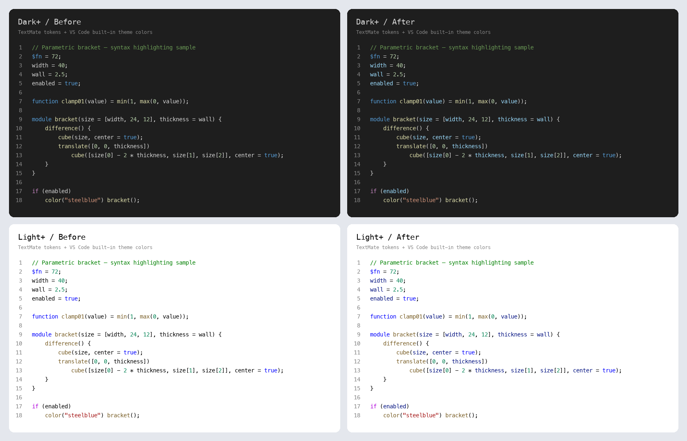

# SCAD AI IDE

基于 VS Code Extension API 的 OpenSCAD 开发扩展。使用 Extension Host 内置 Node.js，不需要独立 SCAD CLI、HTTP 服务或前端开发服务器。

## 使用

在本目录执行 `npm ci`，按 `F5`（macOS 可用 `Fn + F5`）启动扩展开发宿主。F5 开发窗口禁用其他已安装扩展，只加载当前开发扩展和内置扩展；当前工作区同时关闭 JavaScript 调试器的 Network 视图，以避开本机 Node inspector 的网络事件错误。普通断点与变量调试仍然可用。左侧 **SCAD AI IDE** 只有两个独立的原生 View：

- **QUICK ACCESS**：按 AI、Bricks、Libraries、Runtime 顺序显示四个纯文本叶子节点。
- **CUSTOMIZER**：当前或最近使用的 `.scad` 文件的参数分组和参数值。

树节点没有自定义图标，使用普通单行文本；两个 View 可以独立折叠和调整高度。

### OpenSCAD 语言支持

扩展通过 VS Code 标准贡献点和 `vscode-languageclient/node` 集成同仓库的 `../openscad-LSP`，语言 ID 统一为 `openscad`。不需要安装另一个 OpenSCAD VS Code 扩展。

高亮采用与 JS/TS 兼容的标准 TextMate scope：函数/模块声明及调用为 `entity.name.function`，普通变量为 `variable.other.readwrite`，形参和命名实参为 `variable.parameter`，声明关键字为 `storage.type.function`，控制流为 `keyword.control`。在 Dark+ 下对应函数浅黄、变量/参数浅蓝、声明蓝色、控制流紫色，数字浅绿、字符串橙色、注释绿色；Light+ 和其他主题使用各自的调色板。扩展负责分类，具体颜色由主题与用户的 `editor.tokenColorCustomizations` 决定，不修改全局配色设置。主题工作方式见 [VS Code Syntax Highlight Guide](https://code.visualstudio.com/api/language-extensions/syntax-highlight-guide)。

语法规则支持多行参数列表、嵌套默认值、匿名函数、命名实参和变量引用；注释与字符串中的代码保持原有分类。它提供词法高亮，不声称能解析跨文件符号或区分所有同名变量的语义身份。使用 [highlighting.scad](examples/highlighting.scad) 检查实际效果；以下对比由真实 TextMate 分词结果和内置 Dark+/Light+ 主题规则生成（左为修改前，右为修改后，不包含 LSP 语义高亮）。



| 功能                         | 实现方式                                                                                                                                                         |
| ---------------------------- | ---------------------------------------------------------------------------------------------------------------------------------------------------------------- |
| 语法高亮                     | `contributes.grammars` 注册 TextMate grammar，支持注释、字符串、数字、模块/函数声明、库路径、控制关键字和特殊变量                                                |
| Snippet completion           | `contributes.snippets` 提供 module、function、for、if、difference、include、use、region；LSP 额外提供内建和用户符号补全；启用静态片段时隐藏重复的 LSP 关键字模板 |
| 括号匹配、自动闭合、选区包围 | `language-configuration.json`，覆盖 `{}`、`[]`、`()`，以及双引号闭合与包围                                                                                       |
| 注释切换                     | VS Code 原生行注释 `//` 和块注释 `/* */` 命令                                                                                                                    |
| 自动缩进                     | 语言缩进规则，支持代码块、向量、跨行调用、无花括号的单语句控制/变换，以及块注释回车续行；默认四空格                                                              |
| 标记折叠                     | `// #region Name` 到 `// #endregion`（也接受不带 `#` 的 region/endregion）；无 LSP 时普通代码使用 VS Code 缩进折叠                                               |
| 结构折叠                     | openscad-LSP 复用 Tree-sitter 解析树，支持模块、函数、几何/控制块、调用、向量和块注释，不要求源码缩进；同时返回 region 标记                                      |
| 代码智能                     | openscad-LSP 的悬停、定义跳转、重命名、文档符号、诊断和 Topiary 文档格式化                                                                                       |

当前服务端未声明 semantic tokens、引用查找或 signatureHelp 能力；不会将这些功能标记为已实现。函数/模块签名可通过悬停查看。语法高亮与基础编辑功能无需启动服务端，未信任的工作区也能使用。服务端只处理已保存为文件的 OpenSCAD 文档；无标题文档仍有基础语言支持。

首次开发推荐安装 Rust stable 工具链并初始化 `sources/openscad-LSP`，然后在本扩展目录运行：

```sh
npm ci
npm run build:lsp
npm run compile
```

F5 的默认构建任务先执行 `npm run prepare:lsp`，再启动 TypeScript/esbuild watch。准备步骤优先复用扩展内可运行的服务端；有 Cargo 时从源码构建；无 Cargo 时仅在本仓库已有的 `openscad-support-vscode/server` 或 `.build/extensions/unpacked/openscad-support-vscode/server` 中寻找兼容当前主机、支持 `--stdio` 的程序并复制到扩展内。不会在扩展运行时下载程序或修改用户全局设置。

缓存回退仅用于本地开发，可能早于当前源码版本；来源路径、版本和 SHA-256 写入平台目录中的 `provenance.json`。旧开发缓存可能为 2.0.1；当前 openscad-LSP 源码为 2.0.3，结构折叠需要本仓库增强后的源码构建。需要当前源码版本时运行 `npm run build:lsp`；正式 `vscode:prepublish` 始终要求 Cargo 并从源码构建。没有 Cargo 也没有缓存时，准备任务明确失败，避免带着缺失的程序启动 F5。

结构折叠由服务端提供，因此使用外部 `languageServer.path` 或旧开发缓存时，以该程序实际支持的能力为准。LSP 关闭或未接入的文档继续使用原生缩进与 region 折叠；使用 `editor.foldingStrategy: "indentation"` 可强制使用原生折叠。缩进规则是编辑启发式，不是完整语法分析；复杂嵌套表达式的整体排版仍交给文档格式化。

`build:lsp` 使用 `cargo build --locked --release` 编译 **同仓库的 openscad-LSP 源码**，输出暂存在 `.build/lsp`，将当前平台/架构的程序和 Apache 许可证放入 `server/<platform>-<arch>/`。可以用 `CARGO` 环境变量指定 Cargo 可执行文件。服务端内置 OpenSCAD builtins 与 Topiary，无需另外配置 formatter 可执行文件。

在可信工作区打开第一个 `.scad` 文件时，Language Client 自动以 `--stdio` 启动服务端，进程运行在 workspace extension host（包括 SSH、WSL、容器）。可执行文件选择顺序：

1. `scad-ai-ide.languageServer.path` 显式配置的绝对路径。
2. 扩展内 `server/<platform>-<arch>/openscad-lsp`（Windows 为 `.exe`）。
3. 当前扩展宿主 PATH 中的 `openscad-lsp`。

显式配置错误会显示启动提示并保留诊断。运行 **Restart OpenSCAD Language Server** 可重启；**Show OpenSCAD Language Server Output** 查看日志。扩展退出时等待服务端停止。OpenSCAD 几何 Runtime 的选择与 LSP 程序路径独立。

设置 `scad-ai-ide.languageServer.enabled` 可关闭服务端；`searchPaths` 为库绝对目录数组；`defaultParameters` 控制补全片段是否包含默认参数；`indent` 控制格式化空白；`queryFile` 可指定 Topiary 查询文件。修改设置会重启服务端，避免上游库路径只增不减导致旧路径残留。这些设置为当前 workspace extension host 的统一配置，多根工作区共用一个服务端。

VSIX 发布前的 `vscode:prepublish` 自动构建 LSP 和扩展 bundle。每个平台/架构需要分别构建与发布相应 VSIX（例如 macOS Apple Silicon 使用 `vsce package --target darwin-arm64 --no-dependencies`）；`npm run package` 仅构建 JavaScript bundle，不替代 `build:lsp`。从扩展独立源码归档构建时，需提供相邻的 `openscad-LSP` 源码目录。

### 交互式 3D 预览

已将相邻 `vscode-openscad-preview` 的预览实现集成到本扩展，无需安装独立 Preview 扩展。打开已保存为 `.scad` 的文件，点击编辑器标题栏 **Open as Preview**，或按 `Cmd+Shift+V` / `Ctrl+Shift+V`；同一快捷键或 **Reopen as source file** 返回源码。也可通过 **Open With → OpenSCAD Preview** 打开。预览在原标签内替换源码，不改变 `.scad` 默认的文本打开方式。

- Three.js 视口：旋转、平移、缩放、26 方向视角立方体、透视/正交、实体/X-Ray/线框、光照和阴影。
- 场景工具：网格/打印平台、平台原点切换、顶点/边/面吸附测量、剖切及场景树。场景按文件保存在工作区状态中。
- 参数：复用 IDE 的 Customizer 解析器，预览和原生侧栏双向同步每文件覆盖值；支持同名 `.json` 的 OpenSCAD 参数预设、保存、应用、删除及外部变更刷新。
- 渲染：250ms 防抖预览未保存内容，使用 stdin 和源文件目录作为 cwd；源码中的相对 `include`、`use`、`import` 路径按该目录解析。新建的无标题文档需先保存为 `.scad`。
- 输出：STL / 3MF 导出、发送切片软件、预览内编译日志和 **SCAD AI IDE Preview** Output 通道。

预览和导出统一使用 Runtime 页面选择的 OpenSCAD，保留 Flatpak/Snap 的启动参数；SSH、WSL、容器中运行于 workspace extension host。未信任工作区不会运行 CLI。默认使用兼容稳定版的 STL；需要保留颜色时将 `scad-ai-ide.preview.format` 设为 `3mf`，并选择支持该格式的 OpenSCAD。`scad-ai-ide.preview.enableLazyUnion` 同样需要运行时支持。

`scad-ai-ide.preview.slicerExecutable` 可配置扩展宿主上的切片程序绝对路径；空值调用系统默认模型应用。远程开发时它作用于远程宿主，不会自动启动本机切片软件。发送切片软件的模型保存在宿主临时目录，留给切片程序读取；普通预览和导出生成的临时渲染目录在成功、失败、取消后清理。

预览源码的迁移边界和资源打包见 [preview-integration.md](docs/preview-integration.md)。

### Customizer

打开 `.scad` 文件后，Customizer 自动解析并显示参数。未分组的参数直接显示在根层级，只有显式的分组注释才会生成分组节点。点击数字或字符串使用原生 InputBox 编辑，枚举使用 QuickPick 选择，布尔值点击切换。输入会验证类型、数值范围、步长及枚举选项。

当前支持定义在模块、函数或几何代码块之前的单行字符串、有限数字和布尔赋值，以及常见 Customizer 注释：

```scad
/* [Geometry] */
// Model width
width = 40; // [10:5:100]
height = 20; // [0:100]
wall = 2.5;

/* [Options] */
hollow = true;
shape = "round"; // [round:Round, square:Square]
```

支持 `Hidden` 分组隐藏参数，忽略表达式、向量、模块内部变量和不支持的语法。第一阶段使用独立的简单参数与注释解析器，不将其当作完整 OpenSCAD 语法解析器。

修改仅存为当前会话中的每文件覆盖值，不改动源文件。切换文件时恢复各自的覆盖值，切换到管理页或其他编辑器时保留最近的 SCAD 目标，目标文件关闭后清空。没有 SCAD 目标时树为空。

`CustomizerService.getArguments()` / 扩展 API `getRenderArguments()` 输出独立的 `-D` 参数，例如 `['-D', 'width=45', '-D', 'hollow=false']`，供后续 Render / Preview 使用。参数值以 JSON 字面量序列化，不拼接 shell 命令。当前尚未实现渲染或三维预览。

### 管理页面

Quick Access 点击后在当前编辑器组中以普通标签页打开对应的 WebviewPanel，不自动创建分屏。每个页面只有一个实例，重复点击激活原标签，四个页面可同时打开，关闭后可重新创建。

- **AI**：预留 Skills、MCP、Agent Tools、AI Provider 管理入口。
- **Bricks**：预留可复用 Brick 管理入口。
- **Libraries**：预留 Library 和依赖管理入口。
- **Runtime**：展示真实检测结果，支持刷新、添加可执行文件、选择版本、恢复自动发现和查看诊断。

前三个页面目前为占位内容。页面使用本地静态资源和 VS Code 主题变量，配置 CSP，通过 Webview 消息调用 Extension Host 服务，不监听网络端口。

### Runtime

状态栏仅显示纯文本。点击状态栏打开原生 QuickPick，版本与可执行文件路径显示在同一行，并支持按路径搜索。

选择保存到当前扩展宿主的用户设置 `scad-ai-ide.runtimeCommand`，包含 `executable` 和 `argsPrefix`。用户手动设置 `scad-ai-ide.openscadPath` 时优先使用该路径。显式配置失效时保留错误提示，避免悄悄切换到其他 Runtime。

| 平台    | 当前发现范围                                                                                 |
| ------- | -------------------------------------------------------------------------------------------- |
| Windows | PATH、卸载注册表（含 WOW6432Node）、Program Files、用户 Programs、Scoop current 真实版本目录 |
| macOS   | PATH、系统和用户 Applications 的版本化应用包、Spotlight、Info.plist、Homebrew、MacPorts      |
| Linux   | PATH、系统和用户 bin、Snap、Flatpak 的不同安装范围和分支                                     |

所有候选通过 `--version` 验证，捕获 stdout/stderr，执行设置超时，并按真实路径及启动参数去重。Flatpak 保留前置参数，Snap 保留包装器入口。自定义 AppImage 和便携版可通过手动路径或 PATH 使用，暂不扫描任意磁盘目录。

托管 CLI 的预留路径为 `globalStorageUri/runtimes/<platform>-<arch>/openscad`（Windows 为 `openscad.com`），扩展安装目录不存放下载的程序。当前尚未实现下载、安装、更新或删除，也不会删除系统安装的 OpenSCAD。

发现运行于 workspace extension host：SSH、WSL、Dev Container 场景针对相应主机或容器。未信任的工作区不会执行发现和版本检测。

## 代码结构

- `src/extension.ts`：模块初始化、依赖组装、命令和 View 注册。
- `src/core/customizer/`：不依赖 VS Code 的参数解析、校验、覆盖值和 CLI 参数生成。
- `src/core/runtime/`：Runtime 类型与 Manager，统一提供运行时状态。
- `src/platform/runtime/`：文件系统、包管理器、操作系统与 CLI 发现适配。
- `src/features/sidebar/`：两个原生 TreeDataProvider 与参数编辑交互。
- `src/features/panels/`：统一的 WebviewPanel 生命周期及消息处理。
- `src/features/runtime/`：Runtime 配置、状态栏、命令和诊断。
- `src/features/preview/`：预览宿主会话、消息协议、Lit/Three.js 视口和内嵌打印平台资源。
- `src/features/language/`：标准 Language Client、服务端启动与停止、设置同步。
- `syntaxes/`、`snippets/`、`language-configuration.json`：声明式语言功能。
- `scripts/build-lsp.cjs`：从相邻 openscad-LSP 源码构建和暂存平台二进制。
- `media/panels/`：随 VSIX 打包的静态页面。

## 开发验证

```sh
npm run compile
npm test
npm run test:integration
SCAD_VSCODE_EXECUTABLE=/absolute/path/to/code npm run test:preview-editor
npm run format:check
npm run package
```

预览回归包含视角立方体的 26 个方向、几何拾取、相机导航和打印平台原点。`test:preview-editor` 使用隔离的临时用户配置和假 CLI，验证真实扩展宿主中的反复源码/预览切换、未保存内容保留、stdin/cwd、Runtime 启动前缀、参数双向同步、预设与导出；设置 `SCAD_OPENSCAD_EXECUTABLE` 可额外验证真实 OpenSCAD 的 STL/3MF 导出（要求支持 3MF 的版本）。使用本仓库已构建的 Code OSS 时可设置 `VSCODE_SKIP_PRELAUNCH=1 SCAD_VSCODE_EXECUTABLE=../vscode/scripts/code.sh`。

语言单元测试包含真实 TextMate/Oniguruma 分词验证。设置 `SCAD_LSP_EXECUTABLE` 为 openscad-lsp 绝对路径后，集成测试额外验证真实 LSP 补全、模板去重、悬停、跳转、重命名、符号、格式化、诊断、结构折叠（含未保存编辑）和启停，并验证原生回车缩进；未设置时使用扩展内已准备好的服务端；两者都不存在时跳过真实服务端用例。

集成测试默认下载 VS Code，也可以通过 `SCAD_VSCODE_EXECUTABLE` 指定已有可执行文件。测试使用独立配置目录。`npm run package` 生成生产扩展 bundle；VSIX 可用 `vsce package --no-dependencies` 构建，发布身份等元数据在正式发布前配置。

Prettier 使用单引号、4 空格缩进、非必要不使用分号，`printWidth: 1000000` 避免按常规行长换行；ESLint 关闭 `max-len`。保留已有生成器的 esbuild、watch、F5 调试与测试配置。

## Preview 源码同步

手动双向同步工具和基线由本插件维护，不依赖 Builder。在本目录执行 `npm run preview:sync -- status`；默认使用相邻 `../vscode-openscad-preview`，其他位置通过 `PREVIEW_SYNC_PREVIEW_ROOT` 指定。详见 [同步说明](scripts/preview-sync/README.md)。
