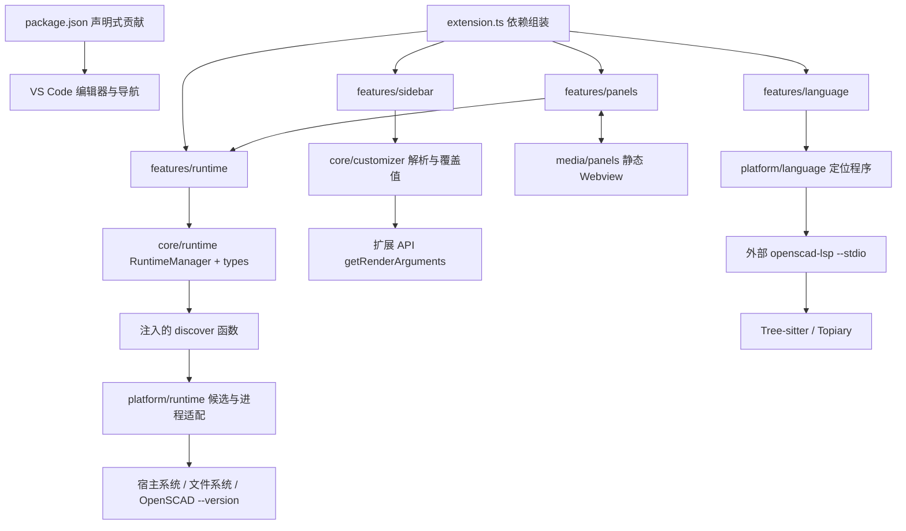
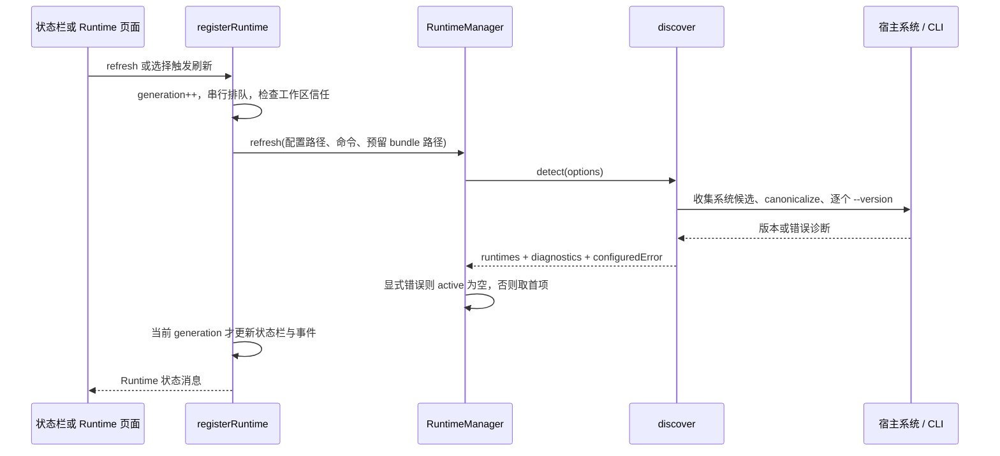

# SCAD AI IDE 当前功能架构与代码架构研究

研究日期：2026-10-21。范围为当前 `sources/scad-ai-ide` 工作区源码，并追查相邻 `openscad-LSP` 中决定集成能力的实现。该子仓库 HEAD 为 `358b38a36bd608a6375c35092bb826cb6a7a2bde`；当前存在大量已修改与未跟踪文件，因此本文描述的是**工作区快照，而非该提交的干净版本**。本次仅新增此研究文档；未改动业务代码。事实来源以源码为准，链接行号对应研究时快照；架构评价与建议明确标为分析。

## 1. 核心判断

当前产品是一个 **VS Code workspace 扩展**：已有“基础语言编辑 + 外部 LSP 集成 + OpenSCAD Runtime 发现选择 + 会话内 Customizer”的开发基础。它没有独立 IDE 外壳、HTTP 服务或前端开发服务器；扩展从 `dist/extension.js` 进入，Node 代码在 Extension Host 执行。不能从名称中的 AI 或 Runtime 的存在推断已具备 AI 建模、编译渲染或三维预览能力。[manifest](../package.json#L13)、[workspace 宿主声明](../package.json#L248)、[激活入口](../src/extension.ts#L13)、[Node bundle](../esbuild.js#L26)

能力成熟度并不均匀：Runtime 页面是真实功能；AI、Bricks、Libraries 是明确显示“尚不可用”的占位页；Customizer 已可输出 `-D` 覆盖参数，但激活入口只是把它作为 API 暴露，尚未连接渲染执行链路。[页面分流](../media/panels/main.js#L3)、[占位文案](../media/panels/index.html#L38)、[参数 API](../src/extension.ts#L27)、[当前预览边界](../README.md#L78)

**架构分析**：目录已经建立 `core → platform → features → extension` 的职责分工，但 Runtime 的业务编排主要仍在 `features/runtime/registerRuntime.ts` 的闭包中，`RuntimeManager` 本身只有检测结果与活动项选择。它适合现阶段规模，距离可复用的 Runtime 安装、执行、任务管理模块还有明显距离。[RuntimeManager](../src/core/runtime/RuntimeManager.ts#L3)、[Runtime 编排](../src/features/runtime/registerRuntime.ts#L8)

## 2. 功能架构与边界

| 领域                    | 当前实现                                                                                                    | 边界与依赖                                                                                     | 源码依据                                                                                                                                                                                      |
| ----------------------- | ----------------------------------------------------------------------------------------------------------- | ---------------------------------------------------------------------------------------------- | --------------------------------------------------------------------------------------------------------------------------------------------------------------------------------------------- |
| 扩展入口与导航          | 启动完成或打开 OpenSCAD 时激活；Activity Bar 下 Quick Access、Customizer 两个原生 Tree View；四个管理页入口 | 纯 VS Code 扩展，不要求 fork Code-OSS                                                          | [activation](../package.json#L13)、[views](../package.json#L149)、[入口](../src/extension.ts#L13)                                                                                             |
| 基础语言支持            | `.scad` 语言注册、TextMate 高亮、snippets、括号/引号、注释、缩进和 region 折叠                              | 不依赖 LSP 启动；不等同于 AST 或 semantic tokens                                               | [贡献点](../package.json#L178)、[语言配置](../language-configuration.json#L1)                                                                                                                 |
| 代码智能                | 文件文档的补全、悬停、定义、重命名、文档符号、格式化、诊断接入                                              | 外部 openscad-lsp；信任工作区且启用后启动；没有声明 references、signatureHelp、semantic tokens | [客户端](../src/features/language/registerLanguage.ts#L24)、[上游 capabilities](../sources/openscad-LSP/src/server/mod.rs#L197)、[诊断](../sources/openscad-LSP/src/server/handler/notification.rs#L44) |
| Runtime                 | 跨平台候选发现、版本探测、真实路径去重、显式选择、自动模式、状态栏、日志与管理表格                          | 当前仅发现/选择和 `--version` 验证；没有几何任务执行器                                         | [候选发现](../src/platform/runtime/discovery.ts#L16)、[探测](../src/platform/runtime/discovery.ts#L115)、[交互](../src/features/runtime/registerRuntime.ts#L116)                              |
| Customizer              | HTML 侧栏、TreeView 样式、标量/向量控件、分组、Comment Hints 悬停、每文件覆盖与预览同步                                  | 独立简化解析器；会话内内存状态；不写源文件，无自动渲染                                         | [解析器](../src/core/customizer/CustomizerParser.ts#L81)、[服务](../src/core/customizer/CustomizerService.ts#L25)、[Tree 交互](../src/features/sidebar/CustomizerViewProvider.ts)         |
| AI / Bricks / Libraries | 可打开、复用和关闭对应标签页                                                                                | 只有导航与占位文案；没有模型提供方、Agent、MCP、砖块或依赖管理实现                             | [导航定义](../src/features/sidebar/QuickAccessTreeProvider.ts#L3)、[占位渲染](../media/panels/main.js#L10)、[HTML](../media/panels/index.html#L38)                                            |
| 托管 OpenSCAD           | 预留 globalStorage 平台目录作为发现候选                                                                     | 当前没有下载、安装、更新或删除功能；目录预留不等于交付了二进制                                 | [候选目录](../src/features/runtime/registerRuntime.ts#L42)、[当前范围说明](../README.md#L105)                                                                                                 |

### 2.1 两套程序、三种解析路径

OpenSCAD Runtime 与 openscad-lsp 是两个独立程序：前者由 Runtime 配置与发现算法选择，当前仅做版本探测；后者由 LSP 专用路径配置、扩展内 bundle、PATH 依次定位，并通过 `--stdio` 运行。选择某个 OpenSCAD 版本不会自动更换 LSP，也没有把活动 Runtime 的路径传给 LSP。[Runtime 配置读取](../src/features/runtime/registerRuntime.ts#L39)、[LSP 启动](../src/features/language/registerLanguage.ts#L28)、[LSP 可执行文件解析](../src/platform/language/serverExecutable.ts#L5)

代码中的解析也分为三条独立路径：高亮采用 TextMate；Customizer 使用 TypeScript 编写的单行标量/注释解析器；LSP 采用 Rust 的 Tree-sitter，并依赖 `tree-sitter-openscad-ng = 0.7.1` 和 `topiary-core = 0.8.0`。当前扩展不会直接加载相邻的 `tree-sitter-openscad` 仓库；构建脚本直接关联的是 `openscad-LSP`。因此修改 sibling grammar 仓库不应被假定会自动改变扩展行为。[TextMate 注册](../package.json#L190)、[Customizer 实现](../src/core/customizer/CustomizerParser.ts#L81)、[Rust 依赖](../sources/openscad-LSP/Cargo.toml#L14)、[源码构建脚本](../scripts/build-lsp.cjs#L6)

## 3. 代码结构与依赖关系

此图是对依赖与调用关系的概括：入口负责实例化；RuntimeManager 接收 `discover` 函数；Webview 通过消息调用 Runtime；语言客户端通过独立程序定位器启动外部服务。箭头不表示所有目录都遵循严格单向分层。[组装](../src/extension.ts#L13)、[函数注入](../src/core/runtime/RuntimeManager.ts#L7)、[Webview 消息](../src/features/panels/PanelManager.ts#L40)、[LSP](../src/features/language/registerLanguage.ts#L30)

| 模块                                      | 职责、状态与接口                                                                                               | 主要依赖                                                                                                                                                    |
| ----------------------------------------- | -------------------------------------------------------------------------------------------------------------- | ----------------------------------------------------------------------------------------------------------------------------------------------------------- |
| `extension.ts`                            | 组合根：注册语言、Runtime、Customizer、Tree、Panel 和命令；返回运行时查询、刷新、参数 API；停用时等待 LSP 停止 | VS Code 与各 feature；[源码](../src/extension.ts#L13)                                                                                                       |
| `core/runtime`                            | `LaunchCommand` 用 executable + argsPrefix 表示启动；Manager 保存 result/active，显式配置错误则 active 为空    | 不依赖 VS Code；[类型](../src/core/runtime/types.ts#L1)、[Manager](../src/core/runtime/RuntimeManager.ts#L9)                                                |
| `platform/runtime`                        | 静态候选、注册表/Spotlight/Flatpak 等探测、app 元数据、路径规范化、进程执行和版本检查                          | Node 文件系统/进程/OS；[discovery](../src/platform/runtime/discovery.ts#L1)、[平台适配](../src/platform/runtime/platformDiscovery.ts#L57)                   |
| `features/runtime`                        | 配置读写、信任判断、异步扫描队列、状态栏、诊断、QuickPick、浏览添加、变化事件                                  | VS Code + Manager + platform；[源码](../src/features/runtime/registerRuntime.ts#L8)                                                                         |
| `core/customizer`                         | 参数类型、文本解析、值校验、按 URI 的覆盖 Map、生成 `-D` 参数                                                  | 无 VS Code 依赖；[Parser](../src/core/customizer/CustomizerParser.ts#L1)、[Service](../src/core/customizer/CustomizerService.ts#L25)                        |
| `features/sidebar`                        | Quick Access 无子项叶节点；Customizer 跟踪编辑器/文档、提供 HTML 侧栏及参数消息校验                                    | VS Code + CustomizerService；[导航](../src/features/sidebar/QuickAccessTreeProvider.ts#L10)、[跟踪](../src/features/sidebar/CustomizerViewProvider.ts)  |
| `features/panels`                         | 按 PageId 复用标签页；装载模板、资源与 CSP；消息派发与销毁清理                                                 | VS Code + Runtime feature 返回对象；[源码](../src/features/panels/PanelManager.ts#L9)                                                                       |
| `features/language` + `platform/language` | 延迟启动、串行重启、设置同步、日志和停止；定位显式/bundle/PATH 程序                                            | vscode-languageclient/node + 文件系统；[客户端](../src/features/language/registerLanguage.ts#L9)、[定位器](../src/platform/language/serverExecutable.ts#L5) |
| `media/panels`                            | HTML/CSS/原生 JavaScript，显示 Runtime 状态与操作，无前端框架                                                  | VS Code Webview bridge；[前端](../media/panels/main.js#L1)                                                                                                  |

**分层评价**：最清晰的隔离在 Customizer core 和可注入的 discovery；两者无需 VS Code 即可测试。RuntimeManager 通过注入隔离探测，但 feature 反过来直接导入 platform，且 `platformDiscovery.ts` 与 `discovery.ts` 相互导入。PanelManager 用 `ReturnType<typeof registerRuntime>` 表达服务契约，将面板绑定到具体注册函数。当前未见实际故障证据，但若功能增长，建议让服务接口与 UI 注册解耦，而不是单纯继续拆文件。[注入边界](../src/platform/runtime/discovery.ts#L131)、[循环依赖两端](../src/platform/runtime/platformDiscovery.ts#L4)、[另一端](../src/platform/runtime/discovery.ts#L7)、[Panel 类型耦合](../src/features/panels/PanelManager.ts#L4)

## 4. 关键运行流程

### 4.1 激活与资源生命周期

`activate()` 同步完成注册并返回 API；Runtime 注册末尾异步触发刷新，语言注册则监听文档并检查已打开文档，Customizer 立即选择当前文档。调用方不应把 `activate()` 返回等同于“Runtime/LSP 已完成就绪”：Runtime 有 `refresh()`，语言有 `ready()`。[入口](../src/extension.ts#L13)、[Runtime 自动刷新](../src/features/runtime/registerRuntime.ts#L170)、[LSP 文档检查](../src/features/language/registerLanguage.ts#L107)、[Customizer 初始目标](../src/features/sidebar/CustomizerViewProvider.ts)

Tree、Panel、命令、事件与输出通道由 subscriptions/Disposable 管理；Panel 销毁会删除映射并清理监听器，扩展停用显式等待语言服务停止。语言 stop 标记 disposed、等待已有重启 Promise，再 dispose 客户端。[扩展 subscriptions](../src/extension.ts#L19)、[面板销毁](../src/features/panels/PanelManager.ts#L66)、[停用](../src/extension.ts#L30)、[语言停止](../src/features/language/registerLanguage.ts#L81)

### 4.2 Runtime 发现、选择与状态同步

候选顺序总体为显式配置 → PATH → 系统安装/包管理器来源 → Snap/Flatpak → 预留托管路径；显式路径优先于显式命令。失败记录为诊断并继续扫描，但任何显式配置错误会阻止 Manager 自动激活其他版本。这是“让用户修正指定 Runtime”的策略，并非“没有找到任何 Runtime”。[候选顺序](../src/platform/runtime/discovery.ts#L28)、[平台候选插入](../src/platform/runtime/discovery.ts#L137)、[显式错误](../src/platform/runtime/discovery.ts#L186)、[active 选择](../src/core/runtime/RuntimeManager.ts#L9)

| 平台    | 发现策略                                                                                   | 特别处理                                                                                                                                                                                                                                                                    |
| ------- | ------------------------------------------------------------------------------------------ | --------------------------------------------------------------------------------------------------------------------------------------------------------------------------------------------------------------------------------------------------------------------------- |
| macOS   | PATH、Applications/用户 Applications/MacPorts、Homebrew/MacPorts 路径；目录扫描、Spotlight | `.app` 读取 CFBundleExecutable，并验证只能是文件名；Spotlight 与应用元数据读取最多 64 项；[静态候选](../src/platform/runtime/discovery.ts#L46)、[动态发现](../src/platform/runtime/platformDiscovery.ts#L77)、[app 解析](../src/platform/runtime/platformDiscovery.ts#L125) |
| Windows | PATH、Program Files/用户 Programs、Scoop、三个卸载注册表 hive                              | 优先 `.com` 控制台启动器；`.com`/`.exe` 同安装去重，路径比较忽略大小写；[候选](../src/platform/runtime/discovery.ts#L58)、[注册表](../src/platform/runtime/platformDiscovery.ts#L70)、[去重](../src/platform/runtime/discovery.ts#L163)                                     |
| Linux   | PATH、系统/用户 bin、Snap、Flatpak                                                         | Snap 保留 wrapper 身份；Flatpak 用 argsPrefix 保留 installation 与 branch；[系统发现](../src/platform/runtime/platformDiscovery.ts#L103)、[Flatpak](../src/platform/runtime/platformDiscovery.ts#L37)、[Snap](../src/platform/runtime/discovery.ts#L156)                    |

程序执行采用 `execFile` 与参数数组，默认超时 5 秒、缓冲上限 4 MiB，接收 stdout/stderr；探测要求绝对路径与可执行权限，并匹配 OpenSCAD 版本输出。Runtime id 是启动命令规范化结果的 SHA-256，并非安装包内容摘要。选择结果写入宿主全局配置，并保留启动前缀参数。[执行与探测](../src/platform/runtime/discovery.ts#L95)、[id](../src/platform/runtime/discovery.ts#L124)、[配置保存](../src/features/runtime/registerRuntime.ts#L75)

**并发分析**：refresh 使用 Promise 链串行执行和 generation 防止过时请求更新状态栏；但已运行的 discovery 没有取消机制，Manager 在 await detect 返回后先写 result/active，feature 才检查 generation。因此这是“过时 UI 提交抑制”，不是完整的“旧结果绝不进入共享状态”。大量慢候选仍可能逐个等待超时；未来任务执行或频繁刷新场景值得把扫描结果提交与取消统一到服务层。[队列与 generation](../src/features/runtime/registerRuntime.ts#L22)、[检查顺序](../src/features/runtime/registerRuntime.ts#L43)、[Manager 写入](../src/core/runtime/RuntimeManager.ts#L9)、[逐项扫描](../src/platform/runtime/discovery.ts#L150)

### 4.3 语言服务

仅首次出现 `scheme=file, language=openscad` 文档才设置 requested 并尝试启动；手动 restart 也可设置 requested。启动必须满足“未销毁、已请求、工作区可信、配置 enabled”，失败写日志并提示。重启串行等待旧客户端 dispose；所有该配置段变化都重启，随后把 searchPaths/defaultParameters/indent/queryFile 转成上游设置字段。[触发条件](../src/features/language/registerLanguage.ts#L74)、[启动门禁](../src/features/language/registerLanguage.ts#L16)、[设置同步](../src/features/language/registerLanguage.ts#L43)、[事件注册](../src/features/language/registerLanguage.ts#L87)

LSP 文档 selector 接受文件 URI，所以已保存文件中的未保存编辑仍可增量同步；限制是**无标题/其他 URI scheme 文档不接入 LSP**，而非“每次编辑都必须保存”。基础高亮、snippet 和 Customizer 另走自己的机制。[selector](../src/features/language/registerLanguage.ts#L34)、[上游增量同步](../sources/openscad-LSP/src/server/mod.rs#L198)、[文档变更](../sources/openscad-LSP/src/server/handler/notification.rs#L22)、[Customizer 接受文档](../src/features/sidebar/CustomizerViewProvider.ts)

上游源码声明补全、定义、悬停、文档符号、格式化、重命名，诊断通过文档变更通知发布；没有声明 references、signatureHelp 和 semantic tokens。客户端只是协议桥接，不能把上游未声明的功能计入本扩展能力。上游库路径更新调用 extend_libs，扩展选择重启以避免旧路径残留；一个客户端实例共享当前 extension host 的设置。[capabilities](../sources/openscad-LSP/src/server/mod.rs#L197)、[诊断与配置处理](../sources/openscad-LSP/src/server/handler/notification.rs#L44)、[路径扩展](../sources/openscad-LSP/src/server/handler/notification.rs#L118)、[单客户端状态](../src/features/language/registerLanguage.ts#L9)

### 4.4 Customizer

解析器扫描语句并跳过字符串和注释中的分隔符，只暴露首个真实 `{` 之前的简单字面量赋值。支持多行赋值、1–4 维数值向量，以及无需分号的 include/use 指令；不加载库、不执行表达式。无花括号的 module/function 定义不会提前终止扫描。Comment Hints 生成最大值/范围/步长滑块、枚举、数字微调步长、文本长度及向量范围；参数前的多行注释作为描述。`Hidden` 隐藏，`Global` 在侧栏根级显示，其他分组以可折叠树行展示。[解析器](../src/core/customizer/CustomizerParser.ts)、[官方规范](https://en.wikibooks.org/wiki/OpenSCAD_User_Manual/Customizer)

覆盖值以 `Map<URI, Map<name, value>>` 保存在会话内存中，不修改原文。重新解析会移除不存在或不合法的值；恢复默认值或重置会删除对应覆盖。数字、字符串、布尔和数值向量均以 JSON 字面量形式传入独立 `-D` 参数；预览与侧栏共享覆盖值，向量预设使用带方括号的字符串保存。[服务](../src/core/customizer/CustomizerService.ts)、[预览参数](../src/features/preview/extension/core/ScadParameters.ts)

侧栏由 `WebviewViewProvider` 提供，资源限定为 `media/customizer` 与 `dist`，CSP 仅允许本地 CSS 与带 nonce 的脚本。自定义 HTML/CSS 使用 VSCode 字体和颜色变量，参照原生 TreeView 的 22px 行高、缩进、折叠箭头、悬停/选择/焦点状态与方向键导航。注释使用 `textContent` 展示，并关联无障碍说明；悬停或聚焦可显示提示，Escape、滚动或切换文档会关闭提示。[提供器](../src/features/sidebar/CustomizerViewProvider.ts)、[视图逻辑](../media/customizer/main.js)、[主题样式](../media/customizer/main.css)

切到非 SCAD 编辑器或管理页时保留最近目标；预览编辑器同样可以选中 SCAD 文档，关闭目标后重新选择或清空。宿主校验消息中的目标 URI 和定义 revision，防止切换文件或源码变更后提交过期值；校验错误显示在参数行。数值变化复用现有 DOM，避免预览同步打断正在编辑的字段；定义变化重建控件并保留分组折叠状态。匹配目标的源码变更仍会重读并解析全文。

Customizer 的外层滚动容器使用微软 `monaco-editor@0.57.0` 发布包中与 VS Code 同源的 `DomScrollableElement`，上游 VS Code commit 为 `6a598d4a13031703d483d103c1d934a36ad27971`。构建只导入滚动组件及其依赖图，不加载编辑器、语言服务或 worker；产物为 `dist/customizer.js` / `dist/customizer.css`，连同原始许可证和 notices 打入 VSIX。`media/customizer/scrollbar.js` 隔离内部 API，包括 DOM 尺寸扫描和原生平滑滚动配置；升级固定版本时必须运行 `npm run test:customizer` 验证交互。

容器复用上游的悬停、拖拽、自动隐藏、淡出和阴影实现，配色由 `--vscode-scrollbarSlider-*`、`--vscode-scrollbar-background` 及 `--vscode-scrollbar-shadow` 提供。列表滚轮灵敏度、Alt 加速和平滑滚动跟随 `workbench.list` 设置；当前宿主的 Modern UI 开启时宽度为 8px，并使用 `--vscode-cornerRadius-small` 圆角；普通模式为 10px。ResizeObserver 与内容变更观察负责更新滚动范围，焦点滚动、分组折叠和文件切换均保持同步，Webview 销毁时释放观察器与滚动组件。

浏览器回归命令：先执行 `npx playwright install chromium`，再执行 `npm run test:customizer`；也可设置 `SCAD_CHROMIUM_EXECUTABLE` 使用已有 Chromium。测试加载真实提供器 HTML 和生产滚动 bundle，保留 CSP，验证滚轮、拖拽、自动隐藏、主题变量、键盘滚动、折叠/缩放、文件切换和配置更新。[文档选择与消息边界](../src/features/sidebar/CustomizerViewProvider.ts)

## 5. Webview、信任与部署边界

PanelManager 用 PageId→WebviewPanel Map 确保每页单实例；在当前编辑组打开，重复打开只 reveal。静态资源局限于 `media/panels`，HTML 的 CSP 默认禁止所有来源，仅允许本地样式与 nonce 脚本。Runtime 路径与版本通过 `textContent` 写入 DOM；宿主只受理 Runtime 页的已知 action，select 还校验 Runtime id 存在。[面板生命周期](../src/features/panels/PanelManager.ts#L29)、[资源与 nonce](../src/features/panels/PanelManager.ts#L35)、[CSP](../media/panels/index.html#L6)、[DOM](../media/panels/main.js#L18)、[消息门禁](../src/features/panels/PanelManager.ts#L40)

工作区未信任时 Runtime 刷新直接 clear，不执行探测；browse/select 也有门禁；LSP 不启动。静态语言贡献和不执行程序的 Customizer 可继续使用。扩展声明 limited untrusted workspace 支持、禁用虚拟工作区；`extensionKind=workspace` 表示 Runtime 与 LSP 针对扩展所在的远程/容器宿主，并非固定本地桌面。[Runtime 信任判断](../src/features/runtime/registerRuntime.ts#L32)、[browse/select](../src/features/runtime/registerRuntime.ts#L91)、[LSP 信任判断](../src/features/language/registerLanguage.ts#L25)、[能力声明](../package.json#L248)

## 6. 构建、二进制与发布

TypeScript 使用 strict、Node16 模块解析和 ES2022；esbuild 把入口及依赖打为 CommonJS Node bundle，仅将 `vscode` 外置，production 开启压缩并关闭 sourcemap。没有 Vue/React 或独立 Web bundler，面板文件直接随扩展分发。[tsconfig](../tsconfig.json#L2)、[esbuild](../esbuild.js#L26)、[面板资源加载](../src/features/panels/PanelManager.ts#L72)

| 命令/入口             | 实际作用                                                                  | 重要边界                                                                                                           |
| --------------------- | ------------------------------------------------------------------------- | ------------------------------------------------------------------------------------------------------------------ |
| `npm run compile`     | check-types + lint + esbuild 开发 bundle                                  | 不构建 LSP；[scripts](../package.json#L210)                                                                        |
| `npm run package`     | check-types + lint + production bundle                                    | 名为 package，但本身不产 VSIX，也不构建 LSP；[scripts](../package.json#L216)                                       |
| `npm run build:lsp`   | 从相邻 openscad-LSP 执行 Cargo locked release，暂存本机平台二进制与许可证 | 要求 Cargo 与 sibling 源码；只 staging 当前平台架构；[脚本](../scripts/build-lsp.cjs#L6)                           |
| `npm run prepare:lsp` | 复用已可运行 bundle；有 Cargo 则源码构建；否则检查两处仓库缓存并复制      | 仅开发 bootstrap；回退写 version/path/SHA-256 provenance，版本可落后于源码；[脚本](../scripts/prepare-lsp.cjs#L10) |
| F5                    | 先 prepare:lsp，再 tsc/esbuild watch，然后 Extension Development Host     | 调试启动禁用其他已安装扩展；[任务](../.vscode/tasks.json#L6)、[launch](../.vscode/launch.json#L8)                  |
| `vscode:prepublish`   | build:lsp 后 package                                                      | 正式打包要求源码构建 LSP，不能把 prepare 的缓存回退当作发布路径；[scripts](../package.json#L211)                   |

相邻 LSP 源码版本是 2.0.3；当前 `darwin-arm64` 目录的 provenance 记录开发缓存为 OpenSCAD-LSP 2.0.1。不能仅凭源码版本认定实际进程也是 2.0.3；provenance 是暂存记录，实际运行版本还需结合最终选中的程序核验。`.vscodeignore` 排除了 src、测试产物、构建脚本与 `.build`，而不是排除运行所需的 media 或 server。[源码版本](../sources/openscad-LSP/Cargo.toml#L1)、[当前缓存记录](../server/darwin-arm64/provenance.json#L2)、[回退 provenance](../scripts/prepare-lsp.cjs#L38)、[打包排除](../.vscodeignore#L1)

**发布分析**：二进制是宿主平台产物，现有 build:lsp 并非交叉编译或自动多平台流水线；远程 Linux extension host 不能使用 macOS LSP bundle。正式交付应按目标平台构建、验证并确认 VSIX 内文件，而不能只验证 JavaScript package 命令成功。[平台目录](../scripts/build-lsp.cjs#L15)、[宿主定位](../src/features/language/registerLanguage.ts#L29)、[发布说明](../README.md#L54)

## 7. 测试覆盖与本次验证

普通 `npm test` 先 TypeScript 编译测试，再由 Node test runner 执行 runtime/customizer/language 三组；VS Code extension 与真实 LSP 集成用例单独归 `test:integration`，不在普通测试内。[scripts](../package.json#L217)、[VS Code test 配置](../.vscode-test.mjs#L3)

| 测试组                | 源码体现的覆盖                                                                                                  | 尚不能据此推定                                                                                                                                                               |
| --------------------- | --------------------------------------------------------------------------------------------------------------- | ---------------------------------------------------------------------------------------------------------------------------------------------------------------------------- |
| Runtime 单元/进程测试 | 顺序、平台候选、注册表和 Flatpak 解析、去重、错误、超时；部分真实 shell stub 与 macOS app 元数据                | Windows/Linux/macOS 全部安装渠道真机可用；[用例](../src/test/runtime.test.ts#L18)、[依赖注入](../src/test/runtime.test.ts#L62)、[真实进程](../src/test/runtime.test.ts#L131) |
| Customizer            | 解析、注释/引号、类型/范围/步长/枚举、按文件覆盖、参数生成、Manager 选择                                        | VS Code 编辑交互与渲染结果；[用例](../src/test/customizer.test.ts#L25)                                                                                                       |
| 语言单元测试          | 语言配置、snippets 贡献、真实 TextMate/Oniguruma 分词、LSP 程序解析顺序                                         | 真实 LSP 协议生命周期成功；[用例](../src/test/language.test.ts#L10)、[分词](../src/test/language.test.ts#L56)、[解析](../src/test/language.test.ts#L85)                      |
| VS Code integration   | View、面板复用、Customizer 目标与编辑、模拟 Runtime 配置；真实 LSP 补全/悬停/跳转/重命名/符号/格式化/诊断与启停 | 缺二进制时真实 LSP 用例会 skip，不能只看 suite 命令退出码；[扩展集成](../src/test/extension.test.ts#L18)、[LSP skip 条件](../src/test/language.integration.test.ts#L31)      |

本次研究的独立核验结果：**`npm test` 22/22 通过；`npm run lint` 与 `npm run check-types` 均退出 0**。这些是本次执行结果，测试范围由上述命令定义限定；没有执行 VS Code integration、完整 VSIX 打包或多平台真机验证，也不能把源码能力声明等同于已验证用户体验。

已静态确认一处集成测试与 manifest 不一致：`extension.test.ts` 严格预期 View 名称 `['QUICK ACCESS', 'CUSTOMIZER']`，当前 manifest 实际是 `['Quick Access', 'Customizer']`。该断言在读取当前 manifest 时不会通过；本次没有运行集成测试，因此这里记录的是**确定的断言输入不一致，不是一次已执行的失败结果**。[断言](../src/test/extension.test.ts#L20)、[实际配置](../package.json#L158)

## 8. 架构评价与演进优先级

以下是基于当前源码的分析建议，并非已经实现的功能，也不是完整安全审计。

1. **先补齐可执行的集成验证。** 修正 View 名称断言漂移，明确真实 LSP 用例是否 skipped，并分别验证开发缓存和源码构建程序。现在单元测试覆盖可复用核心，但 UI/LSP 生命周期仍由另一条未运行链路承担。[测试分流](../package.json#L221)、[断言漂移](../src/test/extension.test.ts#L20)、[skip 条件](../src/test/language.integration.test.ts#L31)
2. **完成最小建模闭环。** 现有 Runtime 的 executable/argsPrefix 与 Customizer 的 `-D` 数组已经提供接点；下一层需要明确 Render/Preview 服务的输入文档、目标 Runtime、覆盖参数、取消、输出文件与错误返回。当前这些服务并不存在，`getRenderArguments()` 只是边界 API。[Runtime 类型](../src/core/runtime/types.ts#L3)、[参数输出](../src/core/customizer/CustomizerService.ts#L72)、[扩展 API](../src/extension.ts#L27)
3. **提取 Runtime 服务契约，再承载安装与执行。** 将扫描状态、活动项、选择策略、generation/取消与事件提交聚拢到独立服务，feature 负责 VS Code 配置和交互，Panel 依赖窄接口；现有薄 Manager 不必为了层级形式而扩充，应围绕真实业务边界演进。[薄 Manager](../src/core/runtime/RuntimeManager.ts#L3)、[feature 状态](../src/features/runtime/registerRuntime.ts#L14)、[Panel 具体返回类型依赖](../src/features/panels/PanelManager.ts#L4)
4. **保留 Customizer 的有限语法契约。** 现在参数解析不执行用户代码，是合适的第一阶段实现。若将来支持向量、表达式或复杂作用域，应先定义 OpenSCAD Customizer 兼容范围和测试样例，再决定是否复用解析服务；高亮、参数提取与 LSP 目前有不同语法来源，不能默认语义一致。[解析边界](../src/core/customizer/CustomizerParser.ts#L138)、[字面量支持](../src/core/customizer/CustomizerParser.ts#L12)、[上游 grammar](../sources/openscad-LSP/Cargo.toml#L19)
5. **按产品闭环推进 AI/Bricks/Libraries。** 当前三个页面只有入口和占位文案；不宜把它们计入现有能力。实现时应先确定状态归属、持久化和服务接口，再为各页添加消息协议；Runtime 页现在是唯一可以参考的完整 Webview→宿主服务→状态回传样例。[占位页](../media/panels/index.html#L38)、[消息协议](../src/features/panels/PanelManager.ts#L40)、[状态回传](../src/features/panels/PanelManager.ts#L17)

现阶段最准确的定位是：**面向 OpenSCAD 的 VS Code 开发扩展基础版，语言和环境选择已有实质实现，参数编辑形成独立核心，AI 管理与几何渲染仍待接入。** 这一定位来自实际注册、实现与调用链，而不是项目名称或目录规划。[组合根](../src/extension.ts#L13)、[功能边界](../README.md#L78)、[占位实现](../media/panels/main.js#L10)
