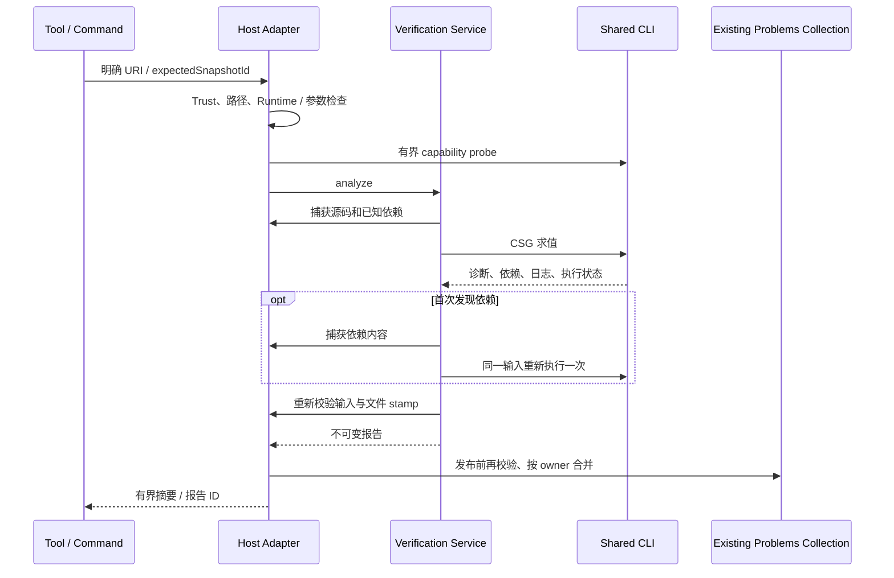

# CAD 验证架构：Phase 0–1

本实现基线为 `8a3ff1fe394b11aeb7fb323e7319bd365d29abaa`，对应 SPEC v1.2。当前只交付 CLI/CSG 诊断和快照治理；Full Render 网格合法性、几何测量、装配、公差、图片、Diff、空间反馈和 MCP 尚未实现。`PASS` 的适用范围必须结合 `checks` 和 `notExamined` 阅读。

## 边界与复用决策

- `core/cad` 持有纯数据、确定性身份、检查汇总、报告、缓存和共享任务；不导入 VS Code 或 Webview。
- `platform/openscad` 负责 CLI 探测、参数数组、子进程、取消、预算、依赖输出及清理。`ScadClient` 是现有 Preview 的兼容调用方；Markdown 继续使用相同 Preview 链。Quick Preview Exporter 保留原路径。
- `CadWorkspaceService` 提供 Extension Host 的文本、Workspace Trust、路径、Runtime、Library 和 Customizer 适配。服务在扩展组合层初始化，无需打开 Preview、Customizer 或 AI Panel。
- 复用唯一的 `scad-ai-ide-preview-source` collection。Agent 与 Preview CLI 发布同一种报告；旧 Preview/Exporter 错误保留适配：其有限源码 stamp 不能当作完整 CAD 验证，明确可解析的同语义 CLI 问题参与去重。图形错误、Customizer 与 Preset collection 继续各自持有职责，LSP collection 不被接管。
- 现有 40 Tools 的 catalog 条目保持不变，追加两个 `cad.*` capability；AI Panel、manifest、VSIX 验证和 Skills 仍由现有生成器维护。没有引入新的几何依赖或自建 LLM 编排器。

## P0 调用链审计

基线的 Runtime command resolver 在 `registerPreview` 注入 `ScadClient`，Markdown 经 Preview 共用该路径；现将注入和执行生命周期提升至 `registerCadVerification`，Preview/Markdown 仍经兼容的 ScadClient。Quick Preview 的独立 Exporter 不迁移到官方 CLI。

基线 `registerPreview` 拥有源码 Problems，`PreviewProblems` 持有视图错误；现由 extension 注册层提供同一源码 collection，视图 owner 生命周期继续独立。Library 的 OPENSCADPATH 来自 `LibraryEnvironment`，有效参数来自 Customizer，Agent 仍经 catalog → Dispatcher → Adapter。没有将 LSP 或 Customizer 自有诊断 collection 合并进 CLI collection。

实施前已知通过项为 check:agents、check-types 和 11 项诊断测试；这不是完整 Host、真实 Agent 或跨平台通过声明。本分支重新执行的完整回归、真实 CLI、Host/模型及未通过项统一见 [验收记录](cad-agent-acceptance.md)。公共接口分别位于 core 的 types、VerificationHost/Service、ReportStore、SharedTasks 和现有 PreviewSourceProblems；Schema v1 与纯契约测试在实现早期建立，后续增加 Host 适配，不引入 vscode 到 domain。

## ADR：身份和新旧结果

`CadSnapshot.id` 使用规范化 JSON 和 SHA-256，纳入源码内容、项目根、依赖内容/状态、环境指纹、有效参数、Runtime 身份/能力、stdin/文件输入方式、执行设置和约束文件摘要。版本号和根缓冲区 dirty 标志为宿主元数据，不单独构成内容身份。报告完整性不改变编译输入 ID。

根源码被冻结为字符串；未保存 include/use 不覆盖磁盘。依赖通过 CLI make 输出及可信错误位置发现，发现新依赖后最多重跑一次。缺失清单、未保存依赖、未知符号、输出截断、重复发现不同依赖图和不完整 Runtime 身份都阻止 PASS。根文件仅参数/注释时检查为 SKIPPED；诊断服务仍让 CLI 检查它，Preview 保留原有提前退出行为。

依赖内容按 Hash 校验，同时比较 inode、纳秒 mtime/ctime 等运行期间的 file stamp，拒绝“执行时改变后又恢复”的输入。已打开根缓冲区版本变化也阻止旧请求提交。旧任务取消采用 generation/revision 与 AbortSignal；失败的稳定性校验不会把绿色报告放入缓存。

官方受管 macOS wrapper 的身份包含其实际 app binary。只用文件 stamp 缓存 Runtime 的内容 Hash，几何/诊断结果仍以内容摘要为身份；未知 shell wrapper 或容器启动器不能提供完整 Runtime 身份时返回 UNRESOLVED。没有将任意脚本当 shell 运行来推断身份。

依赖内容只读取工作区、配置的 Library 搜索根及已选 Runtime 的受支持库目录。无法证明授权的外部依赖标为 unreadable。CAD 报告的源码导航只指向真实可访问的 Workspace 文件，其他位置回退到模型级，并明确无法定位。

## ADR：报告与发布

Schema v1 位于随 VSIX 打包的 `resources/schemas/cad-report-v1.schema.json`；ID 使用本地 URN，不依赖在线 Schema 服务。TypeScript 类型和生成报告由契约测试校验。

- `executionStatus` 与 `overallStatus` 独立；`ok:true` 只表示报告成功送达。
- 必需检查汇总顺序为 FAIL → UNRESOLVED → SKIPPED → PASS。无必需检查、失败执行和不完整输入不允许 PASS。
- 模式仅 `diagnostics`；CSG 不证明最终实体非空、网格合法、装配满足约束或可打印。单位保持 `modelUnits`。
- 每个 Issue 的 fingerprint 绑定快照、规则、可信位置和消息。Problems 按 source owner 保存；清理一个 Preview owner 不清理 Agent owner。
- 导航携带 owner 和 report/stamp 身份，并再次验证输入。旧式无 owner 导航若存在歧义会拒绝。普通 Problems 行单击不保证强制 Text；已有显式 Quick Fix 继续提供保障。
- 只有外部诊断 code、消息和范围完全相同，才抑制重复 CAD 投影；原报告证据保留。外部 owner 移除后恢复有效 CAD 诊断。
- 文件监听覆盖关闭根文件、依赖、Runtime binary、Library 配置和目录；缓存读取、发布和导航前重新校验。打开的只读报告也会更新 current 状态。

## 预算与运行行为

默认显式触发；可配置保存时 diagnostics，默认关闭。每次编辑不启动 Full Render。只读分析仍要求 Trust；不安装依赖、不写用户源码、不扩大原 Customizer 的 CAS/一次性计划/审查权限。

| 资源       | 首版上限                                                                  |
| ---------- | ------------------------------------------------------------------------- |
| CLI        | 同时 1、等待 32、默认 120 s；可配置 1–600 s                               |
| help probe | 10 s，缓存 16 个 Runtime 身份                                             |
| 根文本     | 8 MiB                                                                     |
| 依赖       | 最多 2048；单个 128 MiB、累计 256 MiB                                     |
| CLI 产物   | CSG 2 MiB，其他既有导出 128 MiB                                           |
| 日志/诊断  | head/tail 有界，独立保留 ERROR；诊断截断显式未决                          |
| 报告       | 128 项、30 min TTL、合计 16 MiB，仅内存                                   |
| Problems   | 128 份 owner 结果、每份最多 100 条、投影最多 512 条；完整证据仍按报告读取 |
| 文件监听   | 最多 4096 条，dispose 清理                                                |
| Tool 摘要  | 32 KiB；深度问题/日志按 ID 查询                                           |

同快照调用合并；单个订阅取消只释放自己，最后一个订阅者取消才终止共享工作。源码变动使旧工作退出。CLI 使用 `shell:false` 和参数数组，POSIX 终止进程组，Windows 使用 taskkill 终止进程树；真实 Windows 原生验证仍是独立门禁。临时产物始终清理，即使清理报错也释放队列槽位。

## 后续阶段

Phase 2 再加入原始网格诊断、测量和 CLI 图片；缺陷检查先于 Manifold 修复。Phase 3 加入可选 Manifest、稳定 Parts、装配和不可弱化的约束。Phase 4 加入几何 Diff、空间反馈及明确 profile 下的打印相关检查。Phase 5 的 MCP 必须共享已有领域服务，不能猜测编辑器缓冲区。

本阶段没有把“已有 Manifold/mesh worker”“新增 Tool 数量”或“空 Problems”当作几何能力完成证据。

## 2026-11-13 修复：输入证据与解析命名空间

草稿 Schema v1 增加 `snapshot.inputEvidenceHash`，记录捕获时的 complete/unresolvedInputs，与 CLI 后续形成的报告完整性分开。缓存命中要求当前输入完整；current、执行前后和 Preview 发布比较输入证据 Hash。这样既拒绝不完整输入复用旧 PASS，也允许未知符号等合法 UNRESOLVED 报告保持可读。

`project.dependencyResolutionHash` 独立记录根/已知依赖中 literal include/use 的潜在目标，包含尚不存在的高优先级候选；同时监听这些路径。所选依赖仍使用内容 Hash，候选路径的存在、身份及文件 stamp 用来检测解析命名空间变化。首次发现嵌套依赖可以扩展解析指纹，不误当作 Library 环境变化。源路径统一真实目录形式，跳过注释和字符串中的伪引用，候选最多 2048。根文件 symlink 沿用既有路径策略拒绝；无法证明依赖文件级 symlink 的相对解析上下文时返回 UNRESOLVED；目录别名下的 dirty 根仍受支持。前后执行设置统一为 PreviewExecutionContext。

复审与本轮证据见 [Phase 0–1 修复后审查](cad-phase01-review-2026-11-13.md)。历史报告保留原始失败，本轮结果不回填为过去的 PASS。
