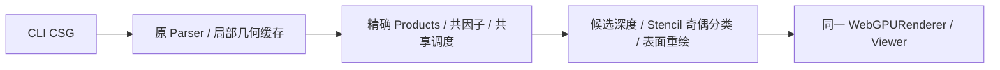

# 装配模型 CSG Pass 预算错误回归（2026-11-02）

用户提供的 `scalable_field_camera/SCAD/assembly.scad` 在 main 合并提交 `05c7cdf` 上精确复现 **365336 estimated passes**。CLI 输出 188050 字节 CSG，工作场景包含 619 个操作数、231 个共享网格、104108 个实例三角形、196 个 Product。用户源码及模型未复制到仓库，也未修改。

## 修复

- 共因子中相同 Product 共享不可变引用，分别限制独立 Product、条件项和引用数量；避免把数万个重复引用当成独立表达式。保留 16384 个独立 Product / 131072 个独立条件项，增加独立的 131072 引用保护。
- 对 DNF 提取共同条件、批处理单条件 OR；每八个操作数使用独立 Stencil 奇偶位。通过 80 组表达式、每组 1024 种赋值穷举检查布尔等价；优化工作量超限只停止提取，剩余条件照常求值。
- 不透明根 Union 在近裁剪面位于所有操作数之前时，共用深度合并各完整 Boolean 分量。只拆根 Union，保留嵌套 Difference/Intersection；共享操作数 DAG、透明/修饰符不应用此优化。内部相机和近面截断恢复完整表达式分类。计划缓存随模型版本失效。
- 每组重置/绘制/判定合并 Render Pass，候选清除/绘制及结果合并/着色也分别合并。中间附件以保守屏幕矩形裁剪；近面相交时使用整个视口。
- 两后端统一使用 Three.js 的左上角 scissor 坐标；Quad 清除遵守裁剪，避免 WebGPU attachment clear 忽略 scissor。深度重置使用开启深度测试的 AlwaysDepth，兼容 WebGL 2。
- **50000 Pass 上限保持不变**，没有隐式最终 CPU Boolean、独立 WebGLRenderer 或 GPU 射线管线。

该模型初始估算从 365336 降至整个表达式 28034，外部不透明视图 11041。后两者是调度估算，非 GPU 硬件计数器。非凸深度层仍按实际探测增加并再次检查预算。

曾尝试凸操作数正反面绕数计数优化，但嵌套相交场景出现 3～4 个深度错误像素，已移除。最终只保留一种独立奇偶分类实现，没有留下实验分支或运行时算法开关。

## 实测

Apple M4 Pro / Metal，Chromium 149.0.7827.55，Three.js 0.187.0，OpenSCAD 2026.10.27。同设备连续执行；每后端每分辨率 20 个完整 GPU 旋转帧，包含完成读回，非纯 JavaScript 提交时间。首画面和参数更新包含两次 rAF，不能代表物理显示器扫描输出时间；基准不包含 VS Code IPC/输入防抖。

| 视口 / 后端 | 首次完整画面 ms | 旋转 P50 / P95 ms | `explode=0.1` 更新 ms | Three.js 资源 MiB |
| --- | ---: | ---: | ---: | ---: |
| 1080p / WebGPU | 1281 | 1296 / 1401 | 1802 | 119.75 |
| 1080p / WebGL 2 | 746 | 242 / 258 | 635 | 119.83 |
| 4K / WebGPU | 1323 | 1399 / 1472 | 1798 | 476.46 |
| 4K / WebGL 2 | 861 | 333 / 342 | 719 | 476.54 |

旧版本两后端均在首帧报 365336 预算错误，没有可比较的旋转帧时间。不能据此宣称获得某个 FPS 提升倍数。新版本能显示和更新，但**这份装配模型仍未达到流畅交互目标**，WebGPU 多 Pass 调度开销尤其明显。

1080p 的 CLI 约 48 ms，局部几何 57 ms，Product 规范化 3.8 ms；WebGPU 上传/Shader 准备约 30/48 ms，WebGL 2 约 25/79 ms。内存数字来自 Three.js 公开统计，未包括浏览器、驱动与 CLI/Worker 全部占用。完整原始样本见 [JSON](csg-raster-assembly-regression.json)。

## 官方 F5 对照与限制

使用相同装配模型、1920×1080、相同透视摄像机，对照 CLI `--preview=opencsg`，不是 F6 网格。两后端都能显示整体装配。排除参考轮廓两像素边带后，2052558 个被检查像素中，WebGPU 有 2934、WebGL 2 有 2897 个差异；官方和当前结果均可见共面干涉伪影，颜色与光照没有逐像素匹配。此对照**未达到装配模型像素一致性通过标准**，不应隐藏残余差异。没有测 Qt 桌面 IDE 的连续旋转帧率。

公开固定测试模型的 F5 对照通过，不代表全部装配模型、库和精度范围均通过。本次修复的是预算膨胀导致普通 CSG 完全无法显示的问题；残余大模型帧耗时、共面/浮点深度伪影，以及 Windows/Linux/Safari/Firefox/其他 GPU 仍需继续验证。

## 验证

- `npm test`：129 基础 + 94 Preview 单元测试通过。
- `npm run package`：类型、lint、生产构建和许可证准备通过。
- WebGPU / `WebGPURenderer({forceWebGL:true})` 1080p：44 基础像素 + 22 批处理/外部与内部视图 + 2 官方 F5 测试（各十个模型）。
- 两后端 4K：44 基础像素 + 22 批处理/视图测试通过。
- Stage：两后端各 20 项通过，涵盖交互、完整帧、版本更新、设备恢复、精确工具及无隐式拓扑。
- Markdown 浏览器预览：10 项通过；重建 Viewer 的暂停测试先等首帧完成，再验证暂停不继续提交，避免把在途准备绘制误判为暂停回归。
- 实际 VS Code Preview Editor：6 组断言通过，包括真实 CLI STL 导出、STL/3MF 打开、Customizer、模式/相机切换。实际模式切换 Webview：1 项通过。

复现性能命令（`SCAD_OPENSCAD_CSG_EXECUTABLE` 指向可运行 CLI）：

```sh
SCAD_BENCH_SCAD=/path/to/SCAD/assembly.scad \
SCAD_BENCH_UPDATE_DEFINE='explode=0.1' \
node scripts/csg-raster-benchmark.mjs /tmp/assembly-1080p.json
```

4K 额外设置 `SCAD_BENCH_WIDTH=3840 SCAD_BENCH_HEIGHT=2160`。自定义源文件相对于其所在目录导入资源，基准不修改模型代码。


