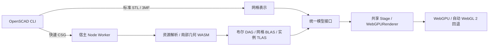

# Three.js 双路径预览

实现使用 Three.js 0.187.0，类型包锁定当前可用的 0.186.0；r187 的 `overrideNodes` 类型在 `tsl-r187.d.ts` 中补充。兼容源码基线为 OpenSCAD `fe482c342ea48bbe749563315741d0e58cdfd57f`。编辑器和 Markdown 默认使用标准 `render`；快速模式值仍为 `preview`。直接打开 `.csg` 默认读取其布尔树。



## 独立核心与传输

`src/core/csg/` 不依赖 VS Code、Lit 或浏览器 DOM。`CsgResourceResolver` 注入读取、字体匹配、依赖状态及三角化能力；默认 Node 适配器使用宿主 XML 解析器。字体、导入、surface 和全部 WASM 都在宿主 Worker 完成。浏览器接收版本化 `CsgPreviewSceneV2`，不调用 CLI、浏览器 Worker 或 WASM。

| 模块                                               | 责任                                                          |
| -------------------------------------------------- | ------------------------------------------------------------- |
| parser.ts                                          | 已展开字面量 CSG、修饰符与根选择；不执行 SCAD/JavaScript      |
| resources.mts / font.mts / fontResolver.mts        | 文件、字体目录、HarfBuzz shaping、FreeType 轮廓及依赖摘要     |
| svg.mts / dxf.mts / nef.mts                        | 导入适配、单位/图层/轮廓与有界 ASCII NEF3                     |
| evaluate.mts                                       | 普通布尔 DAG、实例变换、颜色继承、来源与诊断                  |
| geometry.mts / extrude.mts / curved.mts / roof.mts | 分面几何、强制求值及最小几何屏障                              |
| prepare.mts / acceleration.ts                      | 局部 BLAS、实例 TLAS、重定位与 CPU 边界查询                   |
| validate.ts                                        | 布尔地址、实例矩阵、纹理数据和 BVH 逃逸链接验证               |
| topology.mts                                       | 按需结果拓扑、半空间剖切与封口                                |
| compile.ts / worker.mts                            | 取消、超时、堆预算与网格/BLAS 缓存                            |
| webview/preview/csg/CsgModel.ts                    | 两种后端共用的 TSL 边界、法线、材质、深度和阴影查询           |
| webview/preview/models/ModelRepresentation.ts      | 带模型版本的 prepare/update/render/pick/queryTopology/dispose |

普通三维 union/difference/intersection 首帧只准备叶操作数，不调用整体实体布尔。`render()`、挤出、hull、minkowski、offset、projection、resize、fill 和 roof 等屏障仅实体化其局部子树。顶层二维显示厚度为 1，中心位于 Z=0。非闭合 polyhedron 保留表面和诊断；直接参与实体布尔会明确拒绝未定义的体积分类。hull 可直接使用开放表面的顶点集。

基础几何使用 `$fn/$fa/$fs/$fe` 分面参数。SVG 包含 viewport、DPI、ID/图层选择、开路径 stroke、圆角矩形和原生椭圆采样相位；字体目录读取实际字体元数据，包括集合 face index。依赖包含导入、字体、surface 及同次 CLI `-d` 输出的 include/use 清单，返回结果前复核状态。

## GPU 边界和资源

射线流式寻找有序事件、合并同位置的进出状态并执行布尔程序，不展开并积式，不使用 SDF。射线先经过实例 TLAS，再转换至共享网格 BLAS；局部方向不归一化，以保持事件距离。逆转置矩阵处理非均匀缩放和镜像。相邻三角形使用射线对齐的边函数，BVH 包围盒在局部坐标扩张后求交。

实体模式取第一个有效边界，X-ray 累计布尔结果的区间厚度。差集反转切面法线，剖切作为半空间运算生成封口。位置、法线、来源 ID、颜色和深度作为 TSL 边界输出，`depthNode` 写入真实深度。标准 Three.js 材料节点和环境光照使用实际结果表面；阴影查询相同布尔实体。隐藏剖切平面指示器不关闭剖切效果。

模型和相机使用重定位坐标，视图矩阵在 CPU 双精度中重定位。事件推进不增加固定步长，以免跳过薄壁。事件循环的完整上界来自实例三角形总数；遍历使用栈无关逃逸链接，因此没有猜测的事件数组/遍历栈容量。不会通过截断显示部分结果。

当前显式预算：2,048 个操作数、8,192 条布尔指令、200 万独立三角形、800 万实例三角形、16 个灯光和 8 个剖切平面。数据纹理上限 256 MB，并检查实际设备的二维纹理尺寸。候选管线准备捕获 WebGPU validation/OOM 和 WebGL 着色编译错误。超出预算明确报错。Worker 超时 30 秒，JS 堆和本地 Voronoi WASM 各有 512 MB 上限；这些上限不保证所有设备都有足够资源或达到交互帧率。

## 生命周期和工具

Stage 异步初始化，候选模型上传并编译完成后替换有效画面。版本号、取消、首帧确认和性能消息贯穿宿主与浏览器，过期结果不会替换当前模型。快速失败保留最后有效帧并显示原因，无隐藏 STL 回退。保留一个活动任务和一个最新等待值的调度；首帧确认后启用参数连续拖动。

两种模式共享相机、场景快照和工具设置。CPU 面拾取执行相同布尔程序。顶点/边吸附和精确线框通过宿主 Worker 按需生成结果拓扑，等待时显示状态，模型/剖切变化后失效，不改变模式。拓扑顶点相对独立双精度原点保存，保留大坐标附近的小特征。标准网格通过相同接口返回表面拓扑；带剖切查询复用已有 STL/3MF 字节，在宿主 Worker 生成封口，不重新调用 CLI。

64 MB LRU 同时缓存叶网格和局部 BLAS。实例只保存变换和材质，共享三角形不重复上传。兼容的参数更新复用管线和纹理，仅上传变化区间。相机移动只更新视图；静止 CSG 场景跳过重复绘制。

## 两种 Markdown 入口

保留内置 Markdown 预览；新增 **SCAD AI IDE: Open Markdown Preview with 3D Tools**，也可从 Markdown 编辑器标题栏打开。新增入口由扩展管理 Webview，具有公开宿主消息通道，按需请求拓扑及剖切封口。普通文字修改保留未变化模型的画布、相机和工具状态；模型更新/错误保留最后有效帧。模式可在顶部切换。

内置预览继续通过原贡献脚本显示模型。由于它没有本扩展的直接消息通道，其完整拓扑在首帧发布后由宿主串行准备并通过缓存刷新送达；剖切后的精确拓扑工具提示使用新增入口。这是两个入口的明确差异。

两种入口最多两个活动实例，离屏、Source 标签或隐藏状态暂停绘制，2 秒后释放 GPU 资源。缓存命名空间随 V2 BLAS 布局更新。CSP 不增加浏览器 Worker/WASM 权限；自管入口显式设置 `worker-src 'none'`。它使用 MarkdownIt 安全渲染，不执行 Markdown 内嵌 HTML。

## 验证、基准和打包

```sh
npm test
npm run package
node scripts/csg-coverage.mjs --check
SCAD_OPENSCAD_CSG_EXECUTABLE=/path/to/openscad npm run test:csg-native
SCAD_OPENSCAD_CSG_EXECUTABLE=/path/to/openscad npm run test:csg-gpu
node --test scripts/preview-fast.test.mjs
SCAD_TEST_WEBGPU=1 node --test scripts/preview-fast.test.mjs
node --test scripts/markdown-preview.test.mjs
SCAD_VSCODE_EXECUTABLE=/path/to/code node --test scripts/markdown-webview.test.mjs
SCAD_OPENSCAD_CSG_EXECUTABLE=/path/to/openscad node scripts/csg-benchmark.mjs docs/csg-benchmark.json --gpu
node scripts/verify-csg-package.mjs /path/to/extension.vsix
```

GPU 回归读取 WebGPU 和 `forceWebGL` 的实际像素，覆盖穿孔、深度遮挡、内部视角、正交投影、封口、结果厚度、镜像、共享 BLAS 材质、薄壁和大坐标。固定相机 F5 对照覆盖穿孔、非对称差集、交集和扭转挤出：使用相同分面参数和 FOV，比对几何轮廓，排除 2 像素光栅边缘带；颜色/光照不作逐像素比较。

共享 Stage 的两套浏览器回归覆盖模式/相机保留、参数/导出绑定、精确线框、移动/旋转/缩放 gizmo、活动剖切、灯光、环境、测量显示和 X-ray。真实 VS Code Webview 回归验证内置/自管 Markdown、宿主剖切拓扑和内容更新。原生几何对照覆盖 47 个模型；本机运行时未启用 roof 和 3MF 导入，这两项明确跳过，不能据此声称原生验收已通过。roof 和 3MF 另有本地单元测试。

`native/coverage.json` 从固定子模块提取 22 个序列化方法及离散化字段，是来源清单，尚不代表每一参数组合均已验收。新增原生用例包含凹多边形 polyhedron、开放表面 hull、非凸 Minkowski、projection cut、挤出参数、字体方向/字形、SVG 图层/圆角/椭圆、DXF、PNG/文本 surface 及多格式导入。

`docs/csg-benchmark.json` 记录 CLI、局部几何、BVH、上传、着色准备、首帧和交互帧。GPU 样本仅为 96×96、无阴影的独立视口，每次采样等待 GPU 完成，不能外推为编辑器全尺寸帧率。重复网格样本有 4,608 个实例三角形，仅 72 个独立三角形；这验证 BLAS 共享效果。

WASM、字体及许可证随构建复制至 dist/resources/licenses。`resources/csg/PROVENANCE.md` 固定内核源码、工具链及许可来源；本地重建命令为 `npm run build:csg-kernel`。运行时不读取子模块源码。`npm run build:csg` 可独立构建宿主库 `.build/csg/csg.cjs`，提供编译和按需拓扑 API；VSIX 内附可重建的独立源码归档，并根据实际打包依赖图准备原始许可证。VSIX 冒烟测试在独立临时目录解包，执行布尔、字体及本地 roof 内核，并检查资产和许可证。

## 尚未达到的完整发布门槛

- 全部合法资源变体的原生兼容仍需扩展：例如特殊/无界 NEF3、复杂 DXF 图元、SVG 外部样式/use 组合及字体回退差异；不支持的情况应明确报错。
- 尚未完成每个序列化参数的逐项验收，以及共面/相切/深层差集、多剖切、透明叠加和阴影的完整双后端像素矩阵。
- 当前使用精确数量的流式事件上界和显式设备预算，尚未实现计划所述的设备自适应分档策略。

当前实现提供可运行的双路径核心、自管 Markdown 和真实 GPU/宿主回归，不能作为“全部 OpenSCAD F5 兼容性与验收完成”的发布声明。
