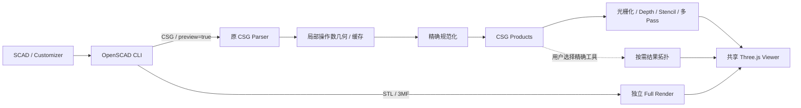

# 光栅化 CSG 快速预览

普通 F5 准备操作数几何和布尔 Product，由 GPU 光栅化求可见表面。使用 Three.js **0.187.0** 的 `three/webgpu`，默认 WebGPU，自动回退 WebGL 2；`forceWebGL:true` 使用同一个算法。没有传统 WebGLRenderer、Compute Shader、GPU BVH、GPU 射线求交或最终布尔网格前置步骤。

完整 STL/3MF Render 保持独立。编辑器和 Markdown 的默认模式保持原配置；`.csg` 直接进入快速管线。



官方源码与 API 实验依据见 [F5 审计](csg-preview-research.md)。本实现对应官方的局部 GeometryEvaluator、CSGTreeNormalizer、CSGProducts、OpenCSG 深度求值和表面重绘；不是把 CLI 导出的 CSG 文本当成已准备好的 VBO。

## 算法

采用 **分层 Goldfeather 奇偶分类**。所有表面产生与内部判定都来自三角形光栅化：

1. 每个操作数保留共享 BufferGeometry、双精度实例变换、颜色、来源、闭合性和凸性信息。普通 union/difference/intersection 保持为布尔 DAG。挤出、hull、minkowski、render、导入等屏障仅求值自己的局部子树。
2. Normalizer 使用补集下推、De Morgan 和分配律生成精确 DNF Product。Product 包含 intersection/subtraction 操作数引用，不复制网格。随机表达式穷举真值表测试覆盖代数变换，禁止近似规则。
3. 对候选操作数 A，准备整个表达式的两个共因子 `F(A=true)`、`F(A=false)`。保留为两个 Product 集合，在 GPU 上求成员状态，避免再展开两者的差/XOR 而导致条件数量膨胀。
4. 光栅化候选正面和背面，将候选深度写到独立 Depth32Float 附件。非凸候选按深度剥离；已知凸基础图元只需一层正面和一层背面。
5. 对共因子 DNF 做保持布尔含义的共同条件提取与单条件 OR 批处理，共享重复 Product 和不可变调度。对 Product 的每个其他操作数，光栅化其所有正反面，丢弃候选深度之前的片元，对通过的片元翻转 Stencil 位。奇偶状态判断候选点是否在该实体内。每批最多八个谓词，失败的组合清除工作可见性；Product 间以最大值混合实现 OR。
6. 将候选**内部一侧**的 `F(A=true)` 成员状态写入 R，将**外部一侧**的 `F(A=false)` 写入 G。近侧采用包含相等深度的计数，远侧采用严格深度计数。只有 `R != G` 才是真正的结果边界。这同时去除内部相机看到的 Union 内部面，并按组处理重合和接触边界。减法内壁根据成员状态反转着色法线。
7. 阶段 A 将有效候选表面合并到结果深度。阶段 B 保留同一结果深度附件，以 `EqualDepth` 重绘真实操作数表面，应用来源颜色、顶点颜色和基础光照。平面法线由 GPU 屏幕导数生成；固定正面/背面 NodeMaterial 避免朝向常量的 Shader 缓存错误。正交与透视共用这套流程。

非凸层数不依赖用户正确填写 `convexity`。每个操作数维护独立的层预算，以额外一层验证是否仍有表面；光栅化最大值归约后，批量读回每操作数一个字节的**深度复杂度元数据**。只有溢出的操作数扩展预算。CPU 不读取或计算整幅可见性，不逐像素遍历三角形。超过 64 个正面/背面层时明确报错，保留最后完整帧。

互不相交、没有剩余布尔约束的边界直接批量绘制原始操作数。不透明根 Union 在能够证明全部操作数位于近裁剪面后方时，以各完整 Boolean 分量的最近表面合并深度；嵌套 Difference/Intersection 不拆开，共用操作数 DAG、透明和修饰符不应用此优化。近面切入模型或内部相机恢复整个表达式共因子，以去除 Union 内部面。分量计划首次使用时准备并缓存，模型更新使其失效；稳定场景相机运动不调用 CLI、Geometry Kernel、Normalizer 或最终拓扑服务。

候选重置与绘制、每组 Stencil 重置/操作数/判定、结果深度合并与着色分别共用 Render Pass。中间工作附件使用保守屏幕区域裁剪；近面相交时保留全视口。RenderTarget.scissor 在 Three.js 两个后端均使用左上角坐标，不能自行重复转换 WebGL 的 Y 轴。清除通过有序 Quad 绘制执行，因为 WebGPU 附件 clear 不受 scissor 限制；写入清除深度必须开启深度测试并使用 AlwaysDepth，保证 WebGL 2 也真正更新深度。没有引入 Backend 修改。

## 模块与数据

| 模块 | 责任 |
| --- | --- |
| `src/core/csg/parser.ts` | 原字面量 CSG Parser、参数/数组、`# % ! *` 和根选择 |
| `evaluate.mts`、几何/资源适配器 | 局部几何、变换/颜色、修饰符、依赖跟踪 |
| `normalize.ts` | 精确 Product 生成与边界共因子，显式复杂度限制 |
| `prepare.mts` | 操作数包围盒、双精度原点、相对变换；不构建 BVH |
| `types.ts`、`validate.ts` | 版本 **3** 的 Geometry/Product 传输与输入验证 |
| `compile.ts`、`worker.mts` | 64 MB 几何 LRU、依赖复核、取消、30 秒超时和 512 MB Worker 堆限制 |
| `acceleration.ts` | 第一次 CPU 面拾取时才构建加速结构；不生成 GPU 数据 |
| `topology.mts` | 用户请求的精确拓扑、测量、剖切封口 |
| `CsgModel.ts` | 共享 BufferGeometry、模型版本/缓存和 Viewer 接口 |
| `RasterCsgRenderer.ts` | 候选深度、Stencil 分类、双侧成员状态和表面着色 |
| `RasterOccupancy.ts` | 非凸层数验证所需的光栅化归约 |
| `CsgFramePass.ts` | 交互帧按 GPU 提交顺序发布，静止/完整质量帧保留 GPU 完成确认；无 Tile 调度 |
| `GpuValidation.ts` | 捕获设备验证、内存及 Shader 错误；静止/完整质量帧成功后才发布 |
| `RendererJobs.ts` | 串行化异步帧和候选准备，保护共享渲染状态与错误作用域 |
| `Stage.ts`、`ModelRepresentation.ts` | 相机、交互、设置、模型更新、错误与生命周期 |

`#`/`%` 经过 Transform、Color 和 Boolean 的传播按官方 CSGTreeEvaluator 处理。预览调试绘制根 `root` 与实体语义根 `topologyRoot` 分离；高亮 Union 的绘制规则不会丢失精确拓扑或拾取中的实体。

Preview 消息不再携带 BLAS/TLAS、重复的三角形纹理或 Hit Event 程序。CPU 查询所需 BVH 仍保留，但完全按需、仅驻留 CPU。相同几何键的变换/颜色更新复用 BufferGeometry；细分变化替换相应缓冲并保留可复用的光栅化 Renderer。共享几何具有引用计数，供主模型和修饰符共用。

删除了旧 GPU Buffer 打包器 `buffers.ts`、射线 Shader、逐 Tile `waitForGPU()`、射线阴影和对应环境阴影钩子，以及不再需要的 `overrideNodes` 类型补丁。没有运行时算法选择项，也没有第二套长期维护的 CSG GPU 管线。

## 交互与高级工具

- 基础实体模式仅使用操作数光栅化。支持颜色、Highlight/Background、相机旋转/缩放/平移、参数及代码更新。
- 基础光照支持最多 16 个方向/点/聚光源和环境光。CSG 不再投射射线阴影或原始操作数假阴影；完整模型阴影和 PBR 外观使用 Full Render。
- 精确 Wireframe、边/顶点测量、X-Ray 和带封口剖切在用户启用时请求最终拓扑。切回普通实体模式后，后续更新不会因历史工具请求继续触发最终 Boolean。
- 面拾取使用懒创建的 CPU 加速查询；模型/剖切版本变化使精确拓扑缓存失效。过期任务不能替换新模型。
- 相机拖动时，CSG 视口临时以最多每 CSS 像素一个设备像素渲染（Retina DPR=2 时像素工作量通常降为四分之一）；松开后恢复原设备 DPR 和完整质量。分辨率变更只发生在 Renderer 无在途任务时，不会每个鼠标事件重新分配帧缓冲。
- 拖动中的 CSG 帧不执行原有的 **每帧 1×1 GPU readback fence**，在同一 GPU 提交队列内完成候选帧与屏幕合成；静止/完整质量帧仍保留 GPU 完成检查和错误作用域。非凸深度复杂度判断所需的标量读回仍按算法要求执行，不能直接删除。首帧 `frameReady` 仍单独等待 GPU 完成和两次 rAF；设备丢失后保留模型与相机并尝试 WebGL 2 恢复。
- `interactiveFrameMs` 不把省略 GPU fence 的交互帧 CPU 提交时间误报成 GPU 帧耗时；仍由带 GPU 完成确认的帧提供。拖动时签名检查只比较 Camera/模型版本，避免每个 rAF 遍历、序列化整个 Scene；松开后恢复完整场景状态检查，其他配置变化仍按现有失效机制触发刷新。相机属性 UI 从 `TrackballControls` 的 change 事件更新，避免每个 rAF 重复写入 Lit Context 和触发持久化防抖。相机在异步帧内使用快照，候选准备和帧绘制不交错修改同一 Renderer。
- 编辑器和自管 Markdown 有按需拓扑消息通道。内置 Markdown 没有该通道，普通 F5 不再后台自动生成完整 Boolean；选择精确工具会提示使用 **Open Markdown Preview with 3D Tools**。基础交互、模式切换和错误保留继续工作，CSP 不开放浏览器 Worker/WASM。

## 有界失败与兼容范围

限制包括 2,048 个操作数、8,192 条 DAG 指令、200 万独立/800 万实例三角形；规范化最多 4,096 个 Product、65,536 个条件项和 100 万工作量。边界共因子和绘制 Pass 也独立限额。CSG 自有附件及完整帧按 512 MB 预算约束，不含 Three.js 默认帧缓冲和驱动开销。非凸层溢出明确诊断，不截断显示部分结果。

开放表面可单独显示，但不能作为闭合 Boolean 体参与分类。自相交/特殊非流形资源、全部 OpenSCAD 库及所有预览修饰符组合没有完整验证。透明材质/修饰符采用基础表面混合，不承诺任意交错透明层的精确排序。未实现基础路径的 CSG 阴影、HDR 环境 PBR 或抗锯齿优化。奇偶分类要求相机远裁剪面位于参与分类的实体之外；普通 Viewer 的模型拟合范围满足此条件，手工远平面截断实体没有单独验收。输入 Float32 几何与浮点深度仍有精度边界；通过大平移、薄壁用例不代表任意尺度组合均可靠。

本机验证覆盖 Apple Metal 上 Chromium 的两种后端。Safari、Firefox、Windows/Linux、独立显卡及真正设备复位后的驱动差异仍需扩展。官方对照使用 CLI 的 **OpenCSG F5 渲染路径**；没有测量 Qt IDE 连续旋转帧率，不能将进程导出 PNG 的时间视为 Qt IDE F5 帧率。完整 F5 兼容性尚未宣称达成。

## 大模型光栅化工作量与有界失败

`src/core/csg/rasterWork.ts` 在 GPU 帧前准备精确边界并保守估算 Raster 工作量；直接操作数按批次计算，非凸模型使用已探测的深度层预算。硬限制仍为 50,000，超过预算保留最后完整画面并明确建议简化模型或选择独立 Full Render。

普通 F5 不设置隐式的完整网格回退阈值，也不会因两次慢帧调用最终 Boolean。25 通孔等普通模型仍使用操作数光栅化，保留 Highlight/Background。内置 Markdown 同样不预计算最终网格；用户明确启用精确工具时，编辑器/自管 Markdown 才请求拓扑。内置 Markdown 没有动态请求通道时会引导打开带 3D 工具的预览。

取消最后一个剖切面后恢复操作数光栅化，并清除面拾取对旧裁切网格的引用；取消工具期间完成的异步结果不会触发新的完整拓扑请求。

## 首帧耗时与“真正 F5”判定

**真正的 F5-style 路径：** `OpenSCAD CLI -D '$preview=true' --export-format csg` 导出实例化 CSG 树，扩展端 Worker 生成局部几何和 Boolean Products，然后 Three.js `WebGPURenderer` 在 WebGPU 或 WebGL2 上执行 Raster CSG Pass。相机变化只重新绘制 GPU Pass，不应重新运行 CLI 或解析 CSG 树。`*.csg` 文件本身不是 WebGPU 可直接消费的 GPU Buffer，仍需要上述准备和规范化。

首帧整体耗时应分别统计：

- `cliMs`：CLI 启动、模型实例化及 CSG 导出（不包含后续 Worker 计算）。
- `geometryMs` / `normalizationMs` / `resourcesMs`：局部几何、Boolean 规范化及资源准备。
- `uploadMs` / `shaderMs`：Webview 首次 GPU 上传和 Shader 预热。
- `topologyRequestMs`：用户启用精确工具后的拓扑请求、宿主求值、传输和本地构建时间；**不能与普通 GPU Raster F5 的耗时混为一谈**。
- `firstFrameMs` / `interactiveFrameMs`：请区分扩展端总耗时、Stage 的首帧上传渲染时间以及 GPU 已完成帧时间；本地离线 1080p 数据不等同于 VS Code Electron 真实画面呈现耗时。

首次显示延迟应按上述分项定位。相机交互只调整分辨率与提交调度，不以隐式 CPU Boolean 换取旋转速度。

## Preview 状态消息统一展示

普通 SCAD Preview 和 Markdown 内嵌 OpenSCAD Viewer 共用 `Preview.ts` 中唯一的 `#preview-status` 左下角状态容器。`App.ts` 不再单独悬浮定位后端卡片，`BackendStatus.ts` 变为内联可展开的性能详情，加载提示也不再建立独立左下角浮层。

- 主状态按 **错误 > 图形设备恢复 > 加载进度 > 工具通知 > 后端摘要** 优先级展示，避免多个状态分别绝对定位、叠加或相互遮挡。
- 同一容器内显示简明的运行后端（CSG/mesh、WebGPU/WebGL2、主要耗时）；完整 CLI、几何、规范化、Shader、拓扑等性能分项默认折叠，点击 `Performance details` 可查看。
- 只有真正错误使用 `alert` 语义；普通分辨率/调度优化不会产生成功弹窗。消息面板有限宽、限高，在嵌入 Markdown 的窄预览中可滚动。
- 没有模型的正常空状态仍使用中央占位；实际的 OpenSCAD CLI `renderError` 则进入左下角统一错误栏，不再作为中央空状态。历史日志保持在 Output 面板，不再在视口内增加另一份状态卡片。
- `scripts/preview-fast.test.mjs` 验证加载、报错、工具提示和后端信息共享一个容器；`scripts/markdown-preview.test.mjs` 验证内嵌代码块采用相同容器。

## 相机交互回归

`node --test scripts/preview-fast.test.mjs` 的 Retina DPR=2 拖拽用例覆盖以下行为：拖动时降低渲染分辨率，免除每交互帧 GPU 读回；松开时恢复 DPR、完整场景签名和验证帧；相机拖动不会改变 CSG 模型版本。设置 `SCAD_TEST_WEBGPU=1` 可在相应浏览器环境中检查 WebGPU 路径，默认浏览器测试会强制 WebGL 2。

**性能注意：** 这是缩短拖拽延迟的帧调度优化，不代表 GPU CSG 本身不再逐帧执行多 Pass。非凸操作数仍可能进行深度层数 readback；高 DPR 的静止全分辨率帧仍有成本。需要在真实 VS Code/Electron 的 Webview 中重新测量连续拖拽的输入到画面延迟、完成帧率与内存，不能直接拿省略 fence 后的 CPU 提交耗时与旧基准比较。

## 复现

```sh
npm test
npm run package
SCAD_OPENSCAD_CSG_EXECUTABLE=/path/to/openscad npm run test:csg-gpu
SCAD_GPU_WIDTH=3840 SCAD_GPU_HEIGHT=2160 node --test scripts/csg-raster.test.mjs
SCAD_TEST_WEBGPU=1 node --test scripts/preview-fast.test.mjs
node --test scripts/preview-fast.test.mjs
SCAD_OPENSCAD_CSG_EXECUTABLE=/path/to/openscad npm run test:csg-native
SCAD_OPENSCAD_CSG_EXECUTABLE=/path/to/openscad node scripts/csg-raster-benchmark.mjs docs/csg-raster-1080p.json
SCAD_BENCH_WIDTH=3840 SCAD_BENCH_HEIGHT=2160 SCAD_OPENSCAD_CSG_EXECUTABLE=/path/to/openscad node scripts/csg-raster-benchmark.mjs docs/csg-raster-4k.json
SCAD_VSCODE_EXECUTABLE=/path/to/code SCAD_OPENSCAD_CSG_EXECUTABLE=/path/to/openscad SCAD_CUSTOMIZER_REPORT=docs/csg-customizer-latency.json node --test scripts/csg-customizer-latency.test.mjs
```

基线复测可将 `SCAD_BENCH_SOURCE_ROOT` 和 `SCAD_BENCH_WORKER` 指向重构前独立检出的源码和构建产物。同一基准同时支持版本化源码快照，不将旧实现加入当前运行时。

GPU 像素测试比较实际轮廓和深度，包含九通孔（跨八位 Stencil 批次）、嵌套、内壁、内部相机、正交/透视、非凸和挤出、凹多面体、镜像/非均匀缩放、接触/重合、大坐标、薄壁、遮挡、颜色及修饰符。深度比较采用参考表面两像素邻域与 3e-6 深度容差，容纳交线处不同三角化的光栅边缘。另验证超过 64 层的受控失败。

官方 F5 对照固定相机、22.5° 透视 FOV、1920×1080 和分面参数；比较十个模型的轮廓，排除两像素边缘带，不逐像素比较光照/颜色。原始记录和截图：

- [WebGPU F5 记录](csg-f5-1080p-webgpu.json)、[WebGL 2 F5 记录](csg-f5-1080p-webgl2.json)
- [高亮差集官方 F5](csg-f5-1080p-highlightedBase-official.png)、[WebGPU](csg-f5-1080p-highlightedBase-webgpu.png)、[WebGL 2](csg-f5-1080p-highlightedBase-webgl2.png)
- [官方 F5](csg-f5-1080p-throughHole-official.png)、[WebGPU](csg-f5-1080p-throughHole-webgpu.png)、[WebGL 2](csg-f5-1080p-throughHole-webgl2.png)
- [修改前首次基线](csg-ray-baseline-initial-1080p.json)、[20 帧旧快照](csg-ray-baseline-1080p.json)、[20 帧新实现](csg-raster-1080p.json)

性能及最终测试汇总见 [验收记录](csg-preview-validation.md)。

交互延迟分支合并后的修复与回归结果见 [合并验收](csg-preview-merge-validation.md)。

实际装配模型的预算错误复现、修复与剩余性能/像素差异见 [装配模型回归记录](csg-preview-assembly-regression.md)。
