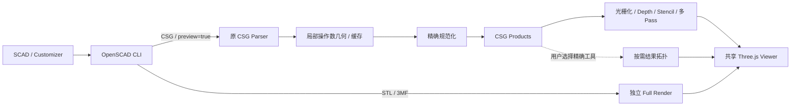

# 光栅化 CSG 快速预览

普通 F5 准备操作数几何和布尔 Product，由 GPU 光栅化求可见表面。使用 Three.js **0.187.0** 的 `three/webgpu`，默认 WebGPU，自动回退 WebGL 2；`forceWebGL:true` 使用同一个算法。没有传统 WebGLRenderer、Compute Shader、GPU BVH、射线求交或最终布尔网格前置步骤。

完整 STL/3MF Render 保持独立。编辑器和 Markdown 的默认模式保持原配置；`.csg` 直接进入快速管线。



官方源码与 API 实验依据见 [F5 审计](csg-preview-research.md)。本实现对应官方的局部 GeometryEvaluator、CSGTreeNormalizer、CSGProducts、OpenCSG 深度求值和表面重绘；不是把 CLI 导出的 CSG 文本当成已准备好的 VBO。

## 算法

采用 **分层 Goldfeather 奇偶分类**。所有表面产生与内部判定都来自三角形光栅化：

1. 每个操作数保留共享 BufferGeometry、双精度实例变换、颜色、来源、闭合性和凸性信息。普通 union/difference/intersection 保持为布尔 DAG。挤出、hull、minkowski、render、导入等屏障仅求值自己的局部子树。
2. Normalizer 使用补集下推、De Morgan 和分配律生成精确 DNF Product。Product 包含 intersection/subtraction 操作数引用，不复制网格。随机表达式穷举真值表测试覆盖代数变换，禁止近似规则。
3. 对候选操作数 A，准备整个表达式的两个共因子 `F(A=true)`、`F(A=false)`。保留为两个 Product 集合，在 GPU 上求成员状态，避免再展开两者的差/XOR 而导致条件数量膨胀。
4. 光栅化候选正面和背面，将候选深度写到独立 Depth32Float 附件。非凸候选按深度剥离；已知凸基础图元只需一层正面和一层背面。
5. 对 Product 的每个其他操作数，光栅化其所有正反面，丢弃候选深度之前的片元，对通过的片元翻转 Stencil 位。奇偶状态判断候选点是否在该实体内。每批最多八个谓词，失败的组合清除工作可见性；Product 间以最大值混合实现 OR。
6. 将候选**内部一侧**的 `F(A=true)` 成员状态写入 R，将**外部一侧**的 `F(A=false)` 写入 G。近侧采用包含相等深度的计数，远侧采用严格深度计数。只有 `R != G` 才是真正的结果边界。这同时去除内部相机看到的 Union 内部面，并按组处理重合和接触边界。减法内壁根据成员状态反转着色法线。
7. 阶段 A 将有效候选表面合并到结果深度。阶段 B 保留同一结果深度附件，以 `EqualDepth` 重绘真实操作数表面，应用来源颜色、顶点颜色和基础光照。正交与透视共用这套流程。

非凸层数不依赖用户正确填写 `convexity`。每个操作数维护独立的层预算，以额外一层验证是否仍有表面；光栅化最大值归约后，批量读回每操作数一个字节的**深度复杂度元数据**。只有溢出的操作数扩展预算。CPU 不读取或计算整幅可见性，不逐像素遍历三角形。超过 64 个正面/背面层时明确报错，保留最后完整帧。

互不相交、没有剩余布尔约束的边界直接批量绘制原始操作数。普通相机运动不调用 CLI、Geometry Kernel、Normalizer 或最终拓扑服务。

## 模块与数据

| 模块 | 责任 |
| --- | --- |
| `src/core/csg/parser.ts` | 原字面量 CSG Parser、参数/数组、`# % ! *` 和根选择 |
| `evaluate.mts`、几何/资源适配器 | 局部几何、变换/颜色、修饰符、依赖跟踪 |
| `normalize.ts` | 精确 Product 生成与边界共因子，显式复杂度限制 |
| `prepare.mts` | 操作数包围盒、双精度原点、相对变换；不构建 BVH |
| `types.ts`、`validate.ts` | 版本 **3** 的 Geometry/Product 传输与输入验证 |
| `compile.ts`、`worker.mts` | 64 MB 几何 LRU、依赖复核、取消、30 秒超时和 512 MB Worker 堆限制 |
| `acceleration.ts` | 第一次 CPU 面拾取时才构建加速结构；不生成 GPU 数据 |
| `topology.mts` | 用户请求的精确拓扑、测量、剖切封口 |
| `CsgModel.ts` | 共享 BufferGeometry、模型版本/缓存和 Viewer 接口 |
| `RasterCsgRenderer.ts` | 候选深度、Stencil 分类、双侧成员状态和表面着色 |
| `RasterOccupancy.ts` | 非凸层数验证所需的光栅化归约 |
| `CsgFramePass.ts` | 完整帧发布与 GPU 完成确认，无 Tile 调度 |
| `RendererJobs.ts` | 串行化异步帧和候选准备，保护共享渲染状态与错误作用域 |
| `Stage.ts`、`ModelRepresentation.ts` | 相机、交互、设置、模型更新、错误与生命周期 |

Preview 消息不再携带 BLAS/TLAS、重复的三角形纹理或 Hit Event 程序。CPU 查询所需 BVH 仍保留，但完全按需、仅驻留 CPU。相同几何键的变换/颜色更新复用 BufferGeometry；细分变化替换相应缓冲并保留可复用的光栅化 Renderer。共享几何具有引用计数，供主模型和修饰符共用。

删除了旧 GPU Buffer 打包器 `buffers.ts`、射线 Shader、逐 Tile `waitForGPU()`、射线阴影和对应环境阴影钩子，以及不再需要的 `overrideNodes` 类型补丁。没有运行时算法选择项，也没有第二套长期维护的 CSG GPU 管线。

## 交互与高级工具

- 基础实体模式仅使用操作数光栅化。支持颜色、Highlight/Background、相机旋转/缩放/平移、参数及代码更新。
- 基础光照支持最多 16 个方向/点/聚光源和环境光。CSG 不再投射射线阴影或原始操作数假阴影；完整模型阴影和 PBR 外观使用 Full Render。
- 精确 Wireframe、边/顶点测量、X-Ray 和带封口剖切在用户启用时请求最终拓扑。切回普通实体模式后，后续更新不会因历史工具请求继续触发最终 Boolean。
- 面拾取使用懒创建的 CPU 加速查询；模型/剖切版本变化使精确拓扑缓存失效。过期任务不能替换新模型。
- 结果提交前验证 GPU 完成，失败保留最后完整帧。首帧通知再等待两次 rAF；设备丢失后保留模型与相机，尝试受控 WebGL 2 恢复。相机在异步帧内使用快照，候选准备和帧绘制不交错修改同一 Renderer。
- 编辑器和自管 Markdown 有按需拓扑消息通道。内置 Markdown 没有该通道，普通 F5 不再后台自动生成完整 Boolean；选择精确工具会提示使用 **Open Markdown Preview with 3D Tools**。基础交互、模式切换和错误保留继续工作，CSP 不开放浏览器 Worker/WASM。

## 有界失败与兼容范围

限制包括 2,048 个操作数、8,192 条 DAG 指令、200 万独立/800 万实例三角形；规范化最多 4,096 个 Product、65,536 个文字项和 100 万工作量。边界共因子和绘制 Pass 也独立限额。CSG 自有附件及完整帧按 512 MB 预算约束，不含 Three.js 默认帧缓冲和驱动开销。非凸层溢出明确诊断，不截断显示部分结果。

开放表面可单独显示，但不能作为闭合 Boolean 体参与分类。自相交/特殊非流形资源、全部 OpenSCAD 库及所有预览修饰符组合没有完整验证。透明材质/修饰符采用基础表面混合，不承诺任意交错透明层的精确排序。未实现基础路径的 CSG 阴影、HDR 环境 PBR 或抗锯齿优化。输入 Float32 几何与浮点深度仍有精度边界；通过大平移、薄壁用例不代表任意尺度组合均可靠。

本机验证覆盖 Apple Metal 上 Chromium 的两种后端。Safari、Firefox、Windows/Linux、独立显卡及真正设备复位后的驱动差异仍需扩展。官方对照使用 CLI 的 **OpenCSG F5 渲染路径**；没有测量 Qt IDE 连续旋转帧率，不能将进程导出 PNG 的时间视为 Qt IDE F5 帧率。完整 F5 兼容性尚未宣称达成。

## 复现

```sh
npm test
npm run package
SCAD_OPENSCAD_CSG_EXECUTABLE=/path/to/openscad npm run test:csg-gpu
SCAD_GPU_WIDTH=3840 SCAD_GPU_HEIGHT=2160 node --test scripts/csg-raster.test.mjs
SCAD_TEST_WEBGPU=1 node --test scripts/preview-fast.test.mjs
node --test scripts/preview-fast.test.mjs
SCAD_OPENSCAD_CSG_EXECUTABLE=/path/to/openscad npm run test:csg-native
SCAD_OPENSCAD_CSG_EXECUTABLE=/path/to/openscad node scripts/csg-raster-benchmark.mjs docs/csg-raster-1080p.json
SCAD_BENCH_WIDTH=3840 SCAD_BENCH_HEIGHT=2160 SCAD_OPENSCAD_CSG_EXECUTABLE=/path/to/openscad node scripts/csg-raster-benchmark.mjs docs/csg-raster-4k.json
SCAD_VSCODE_EXECUTABLE=/path/to/code SCAD_OPENSCAD_CSG_EXECUTABLE=/path/to/openscad SCAD_CUSTOMIZER_REPORT=docs/csg-customizer-latency.json node --test scripts/csg-customizer-latency.test.mjs
```

基线复测可将 `SCAD_BENCH_SOURCE_ROOT` 和 `SCAD_BENCH_WORKER` 指向重构前独立检出的源码和构建产物。同一基准同时支持版本化源码快照，不将旧实现加入当前运行时。

GPU 像素测试比较实际轮廓和深度，包含九通孔（跨八位 Stencil 批次）、嵌套、内壁、内部相机、正交/透视、非凸和挤出、凹多面体、镜像/非均匀缩放、接触/重合、大坐标、薄壁、遮挡、颜色及修饰符。深度比较采用参考表面两像素邻域与 3e-6 深度容差，容纳交线处不同三角化的光栅边缘。另验证超过 64 层的受控失败。

官方 F5 对照固定相机、22.5° 透视 FOV、1920×1080 和分面参数；比较八个模型的轮廓，排除两像素边缘带，不逐像素比较光照/颜色。原始记录和截图：

- [WebGPU F5 记录](csg-f5-1080p-webgpu.json)、[WebGL 2 F5 记录](csg-f5-1080p-webgl2.json)
- [官方 F5](csg-f5-1080p-throughHole-official.png)、[WebGPU](csg-f5-1080p-throughHole-webgpu.png)、[WebGL 2](csg-f5-1080p-throughHole-webgl2.png)
- [修改前首次基线](csg-ray-baseline-initial-1080p.json)、[20 帧旧快照](csg-ray-baseline-1080p.json)、[20 帧新实现](csg-raster-1080p.json)

性能及最终测试汇总见 [验收记录](csg-preview-validation.md)。
