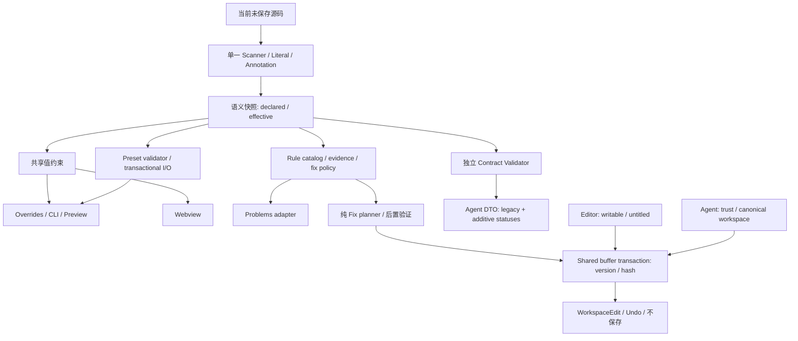

# Customizer Phase 0.5 目标架构与迁移 ADR

日期 2026-11-09。基准及 feature ledger 见 [Phase 0](customizer-audit.md)。以下决定在实现前形成；用户已原则批准方案 B，当前适用的输入与安全边界以末尾“用户审阅后修订”为准。

## 总体方案比较

A：原文件逐项补丁。改动少，但 annotate/Analyzer/DOM/Service 的规则重复会继续增长，不能解决约束和修复漂移。

B：职责重组，保留经过验证的扫描状态机与 piece planner，提取纯 literal/annotation/constraints；新增结构化 rule catalog、受控 fix planner、独立 Preset validation；host 只负责事务与生命周期。迁移调用方，删除被提取的重复规则。这是所选方案：收益直接对应已确认缺陷，不引入通用 AST 框架。

C：用完整 SCAD AST/native 进程取代静态分析。覆盖潜力强，但每次编辑启动 native、跨平台打包和语法依赖成本高；不能在无 native 时保持低延迟，不选。



## ADR-CUST-01: 词法与语义边界（REFACTOR）

- Current implementation / entrypoint: CustomizerParser.ts:scanCustomizer/parseLiteral/annotate，所有消费者依此扫描。
- Evidence: CommentParser.cc:getDescription 仅前一行列首；当前测试断言多行/块描述。Hint lexer 不等于 SCAD literal lexer。
- Completeness & architecture finding: 发现可用，语义缺口确定；单文件职责混合。
- Alternatives: A 单文件增强；B 提取纯 literal 与 annotation、保留 scanner；C 完整 AST。
- Decision: B；Scanner 仍是唯一有效声明发现者，避免第二套正则解析。Parameter 保留兼容出口，增加显式约束字段和不完整原因。
- Maintenance: Hint 语法与源码字符串转义独立测试，Analyzer 不再猜 widget。
- Compatibility / migration: 描述识别、NFC、同一行边界等修正改变可见 schema，先提交具体差分确认；不改源文件。
- Stages / rollback: Phase 1 fixtures→提取→消费者迁移；可按单个提交回退，不触碰用户数据。
- Verification: 正负 fixtures、Unicode/CRLF/BOM、重复赋值/include/use、上游源码和可用 native 对照。

## ADR-CUST-02: declared/effective constraints（REFACTOR + NEW）

- Current: Parameter.range 同时供 Validator、Service 和 DOM；step 网格重复验证。
- Evidence: ParameterObject.cc:parseNumericLimits 扩展边界，Number/Vector importValue 不拒绝 off-grid；StringParameter 有扩大长度的表面意图，但 native probe 仍返回原长度（同名形参遮蔽成员），不能按意图实现。
- Finding: 默认值可能不通过自身校验，GUI/Agent/native 不一致。
- Alternatives: A 覆盖 range 改含义；B 保留 range 为声明值，新增 declaredRange/effectiveRange，提取 browser-safe validateValue；C 每个 adapter 处理。
- Decision: B，旧 range/expectation.range 语义保留；GUI/Service/Preset 仅使用 effective constraints。numericStep 是交互增量，不是合法值网格。文本长度不扩展，遵循 native probe；不引入自动截断。
- Maintenance: 浏览器和 host 导入同一纯函数，删除 DOM 重复校验；不依赖 VS Code/Buffer。
- Compatibility: 扩大可接受输入、描述变化均列待确认；不会夹断源码/default 或重写 Preset。文本 Unicode 计量必须独立记录未知。
- Stages / rollback: Phase 1 模型，Phase 2 UI，Phase 3 Preset；保留 legacy projection 可逐层回退。
- Verification: out-of-range scalar/vector、off-step、默认项、GUI set→service→CLI→Preset 一致性。

## ADR-CUST-03: Rules 与安全 Fix（REPLACE CodeActions；NEW catalog/fix planner）

- Current: Analyzer 的 legacy code 和自由文案；CodeActions 自己正则并直接附 WorkspaceEdit。
- Evidence: provideCodeActions 未接 CodeActionContext；无执行时版本检查。
- Finding: 规则/修复漂移，stale action 风险。
- Alternatives: A resolveCodeAction 生成 edit；B command 调用统一身份/后置校验后提交；C 仅人工提示。
- Decision: B。legacy code 保留；添加 ruleId、evidence、fixId/safety。safe 仅局部唯一替换；review/manual 仅指导。按实际诊断关联 action；Refactor 独立。command 采用 current URI/version/hash 边界；editor 支持实际可写 file/untitled/provider 文档，Agent 保持 trust/canonical workspace 边界，不把 action 参数当权限。
- Maintenance: rule 元数据驱动修复与文档校验；不维护第二套 annotation 猜测。
- Compatibility: 旧 code 不改；灯泡名称尽量保留；取消/过期返回明确结果，不静默保存。安全门收紧需列具体确认。
- Stages / rollback: Phase 2，纯 planner→host command→provider→Host test；原不安全 edit 路径删除。
- Verification: 正反例、幂等、尾注保留、stale/trust/path/cancel、Undo，零 step 不发明新值。

## ADR-CUST-04: Validator 输出（REFACTOR）

- Current: semanticPass 聚合 complete、warnings、target match；issues:string[]。
- Evidence: validateCustomizerSource；现有测试正确要求 includeWarnings=false 不改变 pass。
- Alternatives: A 改 semanticPass 含义（破坏兼容）；B 保留并增加 sourceStatus/contractStatus/qualityStatus 和 details codes。
- Decision: B，不把 contract 注入 Problems；限制所有新字段字节和输出项；扫描复用仅在不引入缓存歧义时进行。
- Maintenance: 明确业务结果，调用者无需解析文案。
- Compatibility: 纯添加 DTO 字段，legacy checked/matched/issues/semanticPass 均保留。
- Stages / rollback: Phase 2 添加字段与契约测试，调用者渐进读取。
- Verification: 隐藏/缺失/错误 widget、warning 隐藏、截断、空目标。

## ADR-CUST-05: 状态与 GUI（REFACTOR；保留树）

- Current: DomainService 持有 active target/revision；ViewProvider 处理消息与 file picker；GUI set 直接调 service。
- Evidence: receiveMessage/set 不检查 preset busy；DOM 自校验；incomplete 无状态。
- Alternatives: A 独立 DTO/store 全重写；B 现有 domain 是唯一状态源，view 仅消息/展示；C Desktop tabs。
- Decision: B + 共享约束。树适合 VS Code 窄侧栏，Global 根节点差异文档化；不引入新 store；GUI 值写经过 domain，保留连续预览 reason。
- Compatibility: revision、target 和 command 不改；旧 overrides 每文件隔离。改善 incomplete 提示属于新增可见行为，列确认。
- Maintenance: 不新增平行状态，减少双份校验。
- Stages / rollback: Phase 2；浏览器 fixture 与真实 Host 各自记录。
- Verification: 所有 widget、键盘/焦点/aria、空/不完整、切换文件、输入错误、continuous Preview。

## ADR-CUST-06: Preset（REFACTOR + NEW validation）

- Current: 纯 parse/decode + I/O watcher；apply 合并旧覆盖；writeFile 重读后无磁盘 CAS。
- Evidence: CustomizerPresets.ts:apply/execute/reload；ParameterSet.cc NFC 与字符串编码。
- Alternatives: A 保持叠加；B 选择 preset 以 defaults+该集重建 overrides；磁盘提交可用重读比较+临时文件 rename；C 新版本文件格式。
- Decision: 格式保持；先测试 A/B→default，提出 B 行为变更待用户确认。validator 独立只针对绑定/显式文件。保留未知参数/额外字段；错误应用前全量验证；文件并发保护不宣称跨进程绝对原子 CAS。
- Maintenance: structured Preset issues 与源 linter 分离，Host I/O 不推断 widget。
- Compatibility: 文件版本/部分集和未知参数策略有行为变化时先确认，绝不自动删除数据；所有写只在用户动作范围内。
- Stages / rollback: Phase 3 分离验证→事务→watcher；原数据不迁移。
- Verification: 部分集合、损坏 JSON、坏值、未知版本/参数、外部编辑/删除、取消/切换与 Preview。

## ADR-CUST-07: Agent 与发布（KEEP registrations；REFACTOR resources；NEW evidence）

- Current: catalog 单源生成 tools/resources/parity；source 与 runtime skills 分离。
- Evidence: registerCapabilities、agent-manifest、已有 baseline handlers 全调用测试；实际模型自动选择未验证。
- Alternatives: A 合并 Source/Overrides tools；B 保持已发布工具并完善描述/引用和失败协议。
- Decision: B，避免扩大写权限和 schema 迁移成本。新增 diagnostics/compatibility references，生成校验防漂移。注册、调用 smoke、真实模型任务三种证据分开。
- Compatibility: 不改 tool name/input schemas/确认机制、engines；现有资源路径继续有效。
- Maintenance: 不重复知识规则；VSIX 内容和 installed Host 验证。
- Stages / rollback: Phase 3 资源，Phase 4 package/host；无账号/模型环境标 NOT RUN。
- Verification: generate/check、VSIX resources、LM invocation、真实模型 MODEL-01..04 单列。

## 模块处置账本

| 模块 | 决策 | 收益/成本与验证 |
|---|---|---|
| CustomizerParser | REFACTOR | 保留 scanner，提取 literal/annotation；减少混合职责，fixtures 对照 |
| CustomizerSourceTypes | REFACTOR | additive 元数据，保持工具兼容，字节限额测试 |
| CustomizerSourceAnalyzer | REFACTOR | catalog/evidence/fix，禁止扩大默认误报 |
| CustomizerSourceValidator | REFACTOR | 独立状态、稳定 details codes，兼容 semanticPass |
| CustomizerSourceEditor | KEEP | piece diff 最小编辑与未目标语义校验有价值；补冲突/组合用例，无证据支持整套 AST 替换 |
| CustomizerDiagnostics | REFACTOR | rule 元数据→Problems，保留 debounce/dispose/settings |
| CustomizerCodeActions | REPLACE | 诊断关联、command CAS，删旧 edit 快照路径 |
| CustomizerSourceDomainService | REFACTOR | 重用 CAS 与限额，增加 safe fix plan 接口，不复制权限检查 |
| CustomizerService | REFACTOR | 约束提取，无 host 依赖 |
| CustomizerDomainService | REFACTOR | GUI/Agent 同一忙碌与 revision 边界 |
| CustomizerViewProvider | REFACTOR | 纯 adapter，不新增领域状态 |
| media/customizer/main.js | REFACTOR | 删除重复校验，改善 incomplete 与错误展示 |
| core CustomizerPresets | REFACTOR | 独立结构化验证，保留无损编码 |
| sidebar CustomizerPresets | REFACTOR | 部分集/并发/错误回滚与 watcher |
| registerCapabilities/catalog | KEEP | 稳定外部 schema；必要描述更新后重生成 |
| instructions/2 Customizer skills | REFACTOR | 补引用、低 token 与失败协议 |
| agent-manifest | KEEP | 当前单源生成有价值，增加资源覆盖校验 |
| literal/annotation/constraints/rule catalog/fix planner/Preset validator | NEW | 最小纯函数职责，无 native/VS Code 依赖 |
| 原 Parser 提取后的重复函数、DOM 重复校验、旧 action edit 路径 | DELETE | 随调用方迁移删除；测试/rg 证明无平行执行路径 |
| fixtures/evidence/progress | NEW | 原生/静态/Host/模型/平台证据分层 |

## 已审阅的具体可见差分（以末尾约束修订为准）

1. 描述仅紧邻上一行列首 //；块/缩进/跨空行和多行累积改为不识别，普通注释原文不修改。
2. native 验证成立后，numeric effective bounds 包含默认值、GUI/Agent/Preset 接受 off-grid 值，step 作为交互增量；range 仍为原始声明。不会改模型默认值。
3. 部分 Preset 切换由旧 override 叠加改为 defaults+当前集；选 Design default 清空 override；保存的 JSON 不改格式。
4. 高置信度诊断增加规则/evidence/fix metadata，validate 增加独立状态/details；旧 code/semanticPass 不变；Quick Fix 变为执行时 CAS 的 command，分别评估 editor 可写文档与 Agent workspace-only 边界。
5. 分组、NFC 与 Hint/native 差分的语义修正仅在逐例有证据后实施；未知 Preset 版本保留并允许只读分析，应用与覆写必须有兼容性依据；UI 显示不完整分析状态。

## 阶段与回退

0/0.5 文档先完成；1 上游 fixtures 与纯语义；2 规则/修复/GUI/Host；3 Preset/Agent/resources；4 全量单测/浏览器/真实 Extension Host/VSIX/installed smoke/清理/性能报告。每阶段记录 exact commands 与 exit status，不能把 compile 当验收。未具备 native/模型/平台环境的项保持 Unverified，记录复现步骤。最终不合并 main，也不自动迁移用户文件。

## 2026-11-09 用户审阅后修订（进入 Phase 1–4）

用户原则批准方案 B 与后续开发，并批准 partial Preset 使用 defaults + 当前集。以下约束覆盖此前建议中不够准确的表述：

- **文本长度**：pinned StringParameter 构造函数中的 maximumSize 形参遮蔽成员；给形参赋值不扩大成员限制。jsonValue 仍导出声明限制；importValue(store=true) 对 std::string 按 UTF-8 字节 substr 截断，可能截在多字节字符中。静态声明与导入必须分别差分，绝不宣称官方扩大文本长度。
- **输入职责**：语法解析保留声明；语义层计算有效数值边界；UI 负责将输入框文本转换为强类型候选；共享 validator 负责类型、有限性、有效边界、文本限制与枚举成员检验。step 是交互增量。Validator 不规范化、不截断、不夹断，不修改默认值；Preset decoder 仅解码并匹配类型。官方 import 的夹断/截断单独记录兼容差异；IDE 拒绝有损应用，向用户报告，不能静默改变工程数值或字符串。NFC 仅用于标识符匹配，不改用户源文本。
- **编辑边界分别评估**：Agent sourceApply 保持显式 workspace file URI + canonical root + trust + CAS + TTL + 确认。编辑器 Quick Fix 是用户明确执行的单文档动作，允许本地工作区外 file 和 untitled 的静态注释编辑；不继承 Agent 的 workspace-only 或 Workspace Trust 限制，不执行模型。两者共享纯修复/后置验证和身份事务检查，host adapter 分别校验目标 scheme/权限；虚拟只读文档不提供写动作。不能以安全重构为由回退现有编辑器能力。
- **未知 Preset 版本**：可解析、只读诊断并保留原版本/所有字段；不能因 pinned reader 忽略版本就断言任意未来版本兼容。仅有特定版本的兼容证据时才允许相应读行为；尚未验证的版本禁止 apply/save/new/delete/export-overwrite，UI/Agent 明确提示，原 JSON 不动。用户第二项“按上游兼容并提示”按第一项详细限制实施。
- **验收标准**：新增 text schema + import 截断差分（ASCII 和多字节），共享 validator 不丢数据测试；Preset A→B→Default 的 GUI/Domain/Preview 一致测试；Quick Fix 在 workspace 外 file、untitled、untrusted 和 readonly scheme 的独立 Host 测试，Agent 越界/trust 拒绝保持；未知版本 read-only analysis 允许，apply/write 禁止并原文件不变。所有不可用/失败/未运行如实记录。

此前“拒绝非工作区文件写入”的 Quick Fix 建议废止，仅适用于 Agent Source Apply；此前未知版本“一律直接允许应用/写入”的建议不采用。重大进一步变化将追加 ADR 和差分依据。


## Phase 1 实施证据补充

- Description、NFC、同一行截止/注释归属、comment lexer 的 decimal/WORD 最长匹配已按 CLI 差分修正。多行向量的 Hint 写到声明首行，末行尾注不被假装识别。原 sourceEdit 的最小 patch 与未目标声明后置校验保留。
- 新增 declaredRange/effectiveRange，legacy range 继续表示声明值。GUI/Service/Preset value validator 共用同一纯实现；Analyzer/Validator 元数据字节计算使用 browser-safe UTF-8 计数，不再依赖 Buffer。
- 浏览器 range 的 step 属性会舍入外部赋值，这是 DOM 的隐含规范化，不应静默改变 default/Agent/Preset 值。选择 step=any 保存实际值，显式键盘事件按 numericStep 递增；舍弃增加第二个数值输入框的方案，避免重复焦点/输入状态。真实浏览器测试证明 default12、Agent13、ArrowRight18 和有效上界120；没有声称已验证 native Desktop 指针量化。
- 数值 maximum-only 的隐式下界是 native 的特殊情况：default=-5 时 `.param` 仍是 min0（不会扩大隐式下界），当前模型忠实保留这一结果并可提供约束冲突提示；不会为统一口号伪造 native 自动扩展。
- include 文件名里的 `{` 在 pinned CommentParser 原始行扫描中仍触发截止。已用存在的空 include 文件复现并纳入 fixture；Scanner 单独处理 Customizer cutoff，不把 filename 的括号当作语言 scope。
- 文本输入上限按 UTF-8 bytes 验证，保留默认原文；DOM 不设置会静默截断的 maxlength。官方 import 的 ASCII/多字节截断通过独立 native runner 记录原始 echo 字节，不在 IDE 中复制有损截断。


## ADR-CUST-08 — Preview Preset 委托与事务存储（2026-11-09，实施中）

证据：Preview SidePanel → ScadWebviewPanel → ScadSession 的旧路径是可达生产入口；旧 save 捕获任意读取失败后创建新文件，会覆写损坏/不可读取的用户 JSON；独立 watcher 在外部变更时重放旧 active set，与侧栏/Agent 的 modified/revision 不一致。故该路径不能 KEEP 为第二个业务实现。

选择：Preview 保留 SCAD renderer/session 和未绑定侧车 JSON 的只读发现。显式选择/保存/删除经注入的 CustomizerDomainService，复用同一 Preset controller、版本策略、目标修订、busy、删除确认及 codec；无 domain 时拒绝写操作，不能回退独立 I/O。已绑定模型镜像 host sets/active identity，元数据更新不写 overrides；实际值由 CustomizerService 事件传播并触发 Preview。后台 session 操作必须匹配当前 target。Preview 消息处理 await 结果，失败由既有通知路径显示。

存储：新增纯 CustomizerPresetTransaction 协调，provider 适配留在 host controller。读取原始 bytes → 同 URI extension lock → 复核 bytes/目标 → 暂存同目录随机文件 → 再复核 → provider rename；失败不更新 active/baseline，清理暂存。保留原版本、未知成员及非目标 sets。不能证明所有 provider rename 原子性，不提供跨进程最终 read/rename CAS；这两个边界明确保留为验收限制。没有降级为原位截断覆写。

取舍：选择委托现有已验证 domain，而不是另建 Preview Preset manager 或仅复用 parse 函数。只读发现与显式绑定职责分开；没有自动绑定任意 JSON，没有任意 JSON 全局诊断。该决定属于用户批准的职责重组；后续重大语义改变仍须补 ADR/依据。

模块决定：ScadSession Preset writer/replay DELETE；ScadSession renderer KEEP；ScadParameters preset selection REFACTOR 为共享 codec 的纯适配；CustomizerPresets I/O REFACTOR；CustomizerPresetTransaction NEW；activation 注入 REFACTOR。生产写入口必须只剩共同 controller。

已执行依据：`/tmp/customizer-phase3-unified-all2.log` core204 / preview98通过；新增 storage 5项测试覆盖外部修改、并发、创建竞态、stage/rename/目标失败、临时清理；Preview session测试覆盖按修订委托、metadata不触发render、后台target拒绝、无domain拒绝。浏览器、Host、provider/Remote与最终VSIX仍须单独验收。


### Phase 4 follow-up: interaction and actual edit quotas

Pinned ParameterSlider.cc positions are minimum-anchored and end at the last whole step. Browser range step=any preserves externally supplied values; trusted pointer interaction now uses shared snapNumericInteraction while programmatic/default/Preset/Agent inputs remain unsnapped. Preview drag uses the same helper when bounded, manual numeric input rejects invalid values without clamping, and keyboard increments remain explicit. Textareas preserve multiline strings; group names are regex-escaped in Preview labels.

Quota audit found SourceEditor bounded intent count but could emit more than50 actual edits. It now rejects plans over50 actual edits; tests demonstrate50 accepted/52 refused, pending32/33, cache16/17 and disposal, preview32KiB, exact1MiB/multibyte overflow and501-item aggregate limits. No existing safety quota was relaxed. Tests/limits do not establish native OS focus, remote-provider atomicity or cross-process CAS.


### Preview incomplete-source preservation

Phase4审计发现renderer的本地ScadParameters.updateDefinitions仍可在临时不完整源码时过滤并回写共享Overrides。修正为ScadParser消费同一有界Analyzer并传complete；不完整时保留最后完整定义及原始已存Overrides，不回写partial schema，恢复后再完整验证。host消息显式携带analysisComplete，Preview显示status并以inert暂停参数/Preset交互；domain拒绝编辑仍是最终保护。会话测试覆盖保留→拒绝值编辑→恢复；Chromium真实焦点与原生Accessibility tree验证inert（Playwright role locator计数本身不能证明原生可访问性）。首次类型检查缺消息字段、首次locator计数断言均失败，已修正并保留日志。

架构复杂度证据：`npm run check:customizer:architecture` 针对core runtime静态import图检查，14个core文件、15个可达模块，无runtime import循环、无VSCode/Node/features/platform依赖。对比基准core7→14文件、非空行812→1150（+338，约42%）；增加独立Hint lexer、约束、规则/fix和Preset事务，删除DOM重复校验及Preview独立写文件/重放路径。指标不是复杂度或正确性的充分证明；没有声称整个项目无循环依赖。

## ADR-CUST-09 — Source Apply 的对象 schema 投影（2026-11-09）

真实qwen3.5:2b-mlx原生Agent已执行Source Analyze（2次错误URI被拒绝后自行纠正），随后生成不存在的command/includeWarnings/mode=unused等Source Apply参数并停在确认。此结果不证明模型错误由schema导致，但暴露了传输边界：sourceApply是唯一根部缺type/object/properties、仅oneOf的业务工具；operation.cancel已有显式object投影。官方Ollama provider将schema原样送入function.parameters，不替此工具生成对象字段。

选择：将两模式共有的参数定义提到根type:object/properties，根additionalProperties=false；保留oneOf两种模式的精确allowed keys、required和mode const。避免重复嵌套定义，保持工具名、合法输入集合、所有额度和拒绝approved/command/跨模式字段的约束。未拆成新工具，也未将错误URI、字符串数字或mode=unused自动规范化。

兼容依据：原分支的每条字段约束原样迁到根部，每个分支仍有同一allowed-key集合、required和互斥mode值，因此接受集合不变。固定旧schema fixture验证两模式、全部5种edit intent、非法类型/缺字段/额外授权字段/混合模式输入与新schema判定一致。native模型行为需用相同模型重测，不据schema测试宣称模型验收通过。

另外补充Skill的真实参数形状与不可使用command字符串的说明。新native测试通过官方Skill slash入口执行，观察实际确认及buffer/validation，保留此前未显式选择Skill的失败记录；没有改动身份检查或提交授权。


ADR09复测：同一qwen3.5:2b-mlx通过官方Skill入口实际读取Skill并调用Analyze，但仍将identity展开到根、加入未知字段，range也未遵循请求。工具以INVALID_INPUT拒绝，buffer/disk未变化；Native最终“no response”。对象投影并未建立模型成功，不据此宣称根schema是唯一原因；旧/新结果都保留。继续异常场景验收。

### 原生 Desktop 差分补充：待实测的交互层

2026-11-09新增官方2026.11.06二进制41例CLI差分，全匹配；相关Customizer/ParameterWidget/parameter源码与pinned相同。源码复核发现Slider.setValue和commitChange经过网格位置，Text控件使用QLineEdit.setMaxLength，不能将CLI的off-grid/UTF-8 import结论扩展为Desktop交互结论。当前原生GUI因已验证锁屏尚未获得控件动态证据；完整矩阵见customizer/native-gui-validation.md。保留用户批准的无损存储、step交互与GUI-Agent一致性政策，不未经实测修改公开行为或宣称Desktop完全一致。


## ADR-CUST-10 — 不可重放的当前值快照（2026-11-10 用户批准方案 A）

真实最低Host复现：`label="abcdef"; // 3` 的源码默认值按已批准政策保留；createPreset成功写出`Snapshot.label="abcdef"`，立即apply同一集失败PRESET_INVALID_VALUE。成功结果同时含PRESET-004诊断，不能据此认为保存正确。源码buffer/disk未变，未dirty。证据：customizer/evidence/preset-default-roundtrip-defect.json。当前生产逻辑尚未更改。

新增native导入差分：显式导入abcdef得到abc，省略字段保持abcdef。max-only `[100]` 的负默认值另有边界：schema显示min0，但NumberParameter没有显式minimum成员，CLI显式导入-5仍为-5；不可把schema、import和Qt控件处理视作同一层。10例本机CLI已执行，见customizer/native-import-default-boundaries.json；最初将负数导入预期为0的假设断言失败，已按实际结果与源码修订，未改产品校验。

方案A（推荐）：当前值不能通过现有无损validator时，new/save/没有已有sets时的export Current在写文件及更新active/baseline之前拒绝，沿用PRESET_INVALID_VALUE，明确指出参数及限制。用户可修正约束注释或显式输入合规值后再保存。不改源码默认值、不截断、不改文件格式。delete及导出已有原始sets不依赖当前快照的合法性；未知版本只读限制仍优先适用。可见变化是此前报告成功的不可重放快照现在报错，故先请用户确认。

方案B：仅省略等于源码默认值且不满足输入约束的字段，保存partial集并提示。可重放时沿用当前源码默认值；若未来源码默认值改变，历史快照也随之改变。这改变快照含义，未经确认不实施。原生有损截断、擅自扩大文本限制或改写源码默认值均不作为备选。

拟定验收：真实Host分别覆盖超长ASCII、多字节文本、max-only负默认值；new/save/export Current失败时不存在新文件，已有文件bytes、active、baseline、Overrides、revision和源码dirty语义不变；修改为合规值后可保存并重新apply。删除已有集和原样export已有sets在当前默认值不合规时仍可操作，未知版本仍拒绝写入。两GUI及Agent使用同一controller，分别验证可见错误。上述新门禁尚未执行，不标PASS。


ADR10实施更新：2026-11-10用户明确批准方案A，并确认Mac已解锁。新增纯encodePresetSnapshot，先执行共享约束校验，再核对官方字符串编码解码后的值和类型；new/save/export Current使用它，delete不计算当前快照，export已有sets仍保留现有字段及格式语义。save在无修改早退前也校验，避免无效默认值被报告成功。modified比较独立保存的强类型baseline，避免数字1与字符串"1"同编码掩盖实际修改。数字/字符串枚举的后序同编码项虽是合法GUI值，但无法在既有官方格式中无损重放，纳入已批准的拒绝策略，不改文件格式或选项顺序。

已执行：core新增三项（含ASCII/UTF8/max-only负数、多控件合法重放、混合枚举类型丢失），npm test为core215/Preview99通过、默认Library26通过/3跳过；最低1.140.0真实Host新增定向1项通过，内部四类fixture检验Agent/GUI dispatcher拒绝、无新文件、旧bytes和revision/Overrides/source不变，修正值后可创建/应用，以及已有sets导出与真实storage controller删除不依赖无效当前默认值。该删除证据不宣称点击了GUI确认弹窗。浏览器36通过，包含New/Export错误可见与真实文本修改后保存。首次Host测试编译缺readFile及Thenable/Promise类型错误已修正；首次Chromium受限沙箱Mach端口启动失败保留，授权原生执行后通过。

原生Desktop动态证据已开始取得：显示offgrid12→10、textabcdef→abcd，但初始runtime echo仍12/abcdef；不得把显示裁剪直接说成默认运行值改变。原生键盘spin1.25→1.5及对应echo已观察；Preset列表A/B已实际读取，但自动选择与其他交互仍需可靠目标/焦点及预览完成门禁，首轮失败/不充分结果不计PASS。详见后续GUI验收记录。


ADR10后续复核修订：baseline不能由官方字符串编码反解，因为部分Preset省略的source default本身可能无法无损编码。host现在独立保存深拷贝的ParameterValue baseline，modified直接比较类型和值，文件格式仍是官方字符串。新增浏览器反例：默认字符串"1"但enum数字1在先，部分集省略mode时不虚报modified；有意改为数字1后可保存并正确重放。最终浏览器38通过。

原生GUI验收补充：官方Desktop12项交互与echo全部执行通过，source buffer/disk及偏好不变；A→B→Default符合defaults+当前集。Qt默认显示量化/裁剪并不等价于runtime默认值改变。详见customizer/native-gui-validation.md。保留无损IDE输入政策，不擅自模仿Qt显示裁剪或UTF16长度限制。没有宣称完整pinned GUI或Windows/Linux桌面已验证。

ADR08 生命周期补充（2026-11-10）：实际复现旧 Preset controller 销毁后 select 仍清空共享 Overrides（9→空）；旧 Domain 销毁后仍接受旧 revision 并将9改为10。销毁现在禁止重绑定、回调重载及后续变更，释放 controller 的文件缓存与 Domain 私有源码引用，保留共享 CustomizerService 的新 owner 状态。过期 Domain 变更返回既有 TARGET_CHANGED，不引入新公开错误或更改活动会话语义。浏览器40项及最低真实 Host33项通过，包含实际 watcher 回调重放、set/reset/preset 拒绝和共享状态不变。这是局部功能与引用释放证据，不能代替整个应用的 heap 生命周期验收。中间 VM 跨 realm 空数组断言及真实文件 watcher 导致 STALE_STATE 的失败保留，不放松 CAS。

ADR09 资源补充（2026-11-10）：实际mimo标签三目标首测中，Validate先把expectations编码成字符串/加入未知hideParameter字段，之后一次实际Validate返回semanticPass=false；四次生成Apply仍出现annotateExisting缺widget、changeWidget带defaultValue。6分钟观察期限结束，0次Apply进入dispatcher，源码不变。这不是安全门失效，也不是正常完成的模型验收失败。Skill入口补齐每种intent的严格字段、defaultValue仅用于insert、widget edit合并描述/分组、expectations为对象数组及visible:false。示例使用非验收fixture的radius，不内嵌实际identity或planId；不改schema接受语言、工具名、安全配额或Source实现。资源重包、40/2/5校验与最低Production实际安装功能smoke通过后，按用户指定的本地mimo-v2.6:latest重跑四场景，每项观察上限15分钟，旧模型与本轮超时证据保留。

## ADR11（2026-11-10用户已批准，实施中）— 成功 Source Plan 的结构化后续调用

事实：mimo四场景均实际结束。三目标场景最终Plan→Commit→Validate成功且磁盘不变，但先有3次实际INVALID_INPUT commit，额外生成的无效调用另记；最终回答错误声称以“只含edits”提交，原始成功请求实际为mode+planId。尾注场景4次重复Plan和被拒的普通文件写请求，违反SPEC9.3两次重试与任务写入边界。MODEL-01/02的窄断言可分别证明，不能据此宣布协议与回答整体通过。MODEL-03/04窄断言通过，旧qwen失败不覆盖。原始证据见evidence/mimo-{author,tail,expression,failure}-intents。

方案A（推荐，待批准）：在现有成功SourceApply plan的data中增加continuation，值为固定tool名称、仅mode/planId的input及requiresReview=true。示意（此id仅为说明，不可调用）：

```json
{"continuation":{"tool":"scad_ai_ide_customizer_sourceApply","input":{"mode":"commit","planId":"<actual successful data.planId>"},"requiresReview":true}}
```

只在成功计划返回此字段；失败结果不提供可提交动作。opaque planId由实际计划池产生，没有用户字符串代码或授权标记。该字段是待审阅的候选调用，不自动执行；Native工具确认、Workspace Trust、canonical workspace、TextDocument version/SHA、120秒TTL、single-use、输入schema与限额全部保持。返回结构可减少模型混用plan和commit字段，但不能证明LLM一定遵守重试预算或不再产生错误回答。

方案B：保持返回格式，只继续维护Skill/示例。优点是无公开结果变化；缺点是本轮已明确描述two-field commit，仍有真实混用和错误总结。

方案C：接受携带plan参数的commit或自动剥离无关字段。拒绝：会放松现有严格输入语言并隐藏无效请求；不为模型通过而弱化校验。无需审批，因为不实施。

A为新增公开返回字段，依据用户“改变公开行为先确认”先请求批准，当前未实现。批准后验收：成功plan的continuation.input逐字节包含实际planId且无uri/identity/edits；真实Host以该对象提交并验证3目标/未保存/磁盘不变；用户取消、stale、expired、single-use仍拒绝且无额外编辑；失败plan无continuation；catalog/生产安装与四场景模型回归独立记录。模型次数/回答正确性仍逐项审阅，不把新增字段本身写成模型PASS。

ADR11批准记录：用户明确批准方案A，并要求仅成功Plan返回实际planId/已注册tool；requiresReview不构成授权，严格Commit schema和全部确认/Trust/CAS/TTL/一次性保留。新增直接使用continuation.input的合法提交及expiry/replay/source-change/trust-revoke/cancel测试，并用真实mimo分别报告调用成功率与任务结果。批准前提案保留为决策历史，以下实现与测试继续，不重复索要授权。

ADR11实施与当前验证：成功plan返回continuation，tool由同一catalog解析，input只有mode=commit与实际planId，requiresReview只存在输出。未改Commit schema/安全额度/确认适配。失败Plan及Commit结果无continuation。Node capability32通过，直接使用continuation.input提交合法，requiresReview/approved/skipConfirmation额外字段拒绝；expiry、repeat、version/hash变化、close、trust撤销与cancel按既有精确错误拒绝，buffer不变；真实AgentToolAdapter仍产生confirmation并将取消映射CANCELLED。新增真实最低Host三目标通过strict dispatcher直接提交/取消/额外字段拒绝/一次性/源码CAS，完整34项最终通过。新测试首次VM错误类跨realm导致31/1，修正夹具构造器一致性后32通过，未放宽产品错误处理。

同轮Preset实际Host在create时出现STALE_STATE，另加确定性controller+Chromium复现：相同文件watcher事件令revision5→6。现在仅对实际file/existence/error状态改变发布更新，文件写事务仍比较原始bytes；真实文件更改仍使旧revision失效。浏览器41通过，真实Host原I/O场景通过。首次全Host30/4，其中3项因测试profile误关闭LSP；修正profile后33/1，Editor原生Undo多空行；添加仅合成文档phase/event trace后34通过，但未证明偶发输入根因，保留原失败。原生mimo复测及UI取消探针接续进行，不能把上述自动测试写成模型问题已解决。
