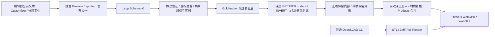

# Preview Exporter 与 Goldfeather 图像空间预览

更新：2026-11-03。直接修改 `main`，不创建分支或 PR。根据最新界面要求，快速预览入口按钮和左下角性能面板现已隐藏；普通预览、加载和错误提示保留。下文的计时实现及数据协议仍保留，性能面板不再挂载到 Preview 界面。裁剪、线框和 XRay 切换入口继续隐藏。

## 当前执行边界



官方 C++ 完成几何求值、三角化及 Products 生成。IDE 直接消费这些操作数和 Products，在屏幕空间计算 Boolean 可见表面。没有 TypeScript CSG Parser、网格 Boolean、CSG 表达式归一化、Manifold WASM 快速几何求值，也没有 GPU 射线/BVH 片元求值。

已经删除此前 `.csgp → polyhedron / difference / union → 原生 binstl → 最终网格` 的管线，包括 `materialize.ts`、`nativeSurfaces.ts`、`meshScene.ts`、`preview-mesh-1` 协议和对应生成器、测试网格。Full Render 仍使用独立普通 CLI；其通用 STL/3MF 工具 Worker 不接受 `.csgp`。

## 官方算法与浏览器实现的对应

参考本仓库 `sources/openscad/src/glview/preview/OpenCSGRenderer.cc`，以及 [OpenCSG 1.8.2](https://www.opencsg.org/) 的 `renderGoldfeather.cpp` 和 `primitiveHelper.cpp::renderLayer`。

1. 共享原始三角网格，以实例矩阵定位操作数。矩阵来自官方数据；不反推或伪造 AST。
2. 正操作数选择正面、负操作数选择背面。以 stencil `EQUAL layer` 配合饱和 `INCREMENT` 选择候选层；遍历官方 convexity 指定的层数。
3. 将候选深度和有效标记写入浮点纹理，同时保留深度/模板附件。
4. 对其他操作数关闭颜色和深度写入，用 `GREATER` 深度测试和 stencil `INVERT` 统计候选表面后方的奇偶交点，采用 z-fail 方式处理近裁面切入减法体的情况。
5. 正项要求奇数、减项要求偶数；全屏模板裁剪将不满足条件的候选标记清零。
6. 重绘候选表面，仅接受有效标记且原生光栅片元深度严格相等的片元，最终通过普通深度比较合并 Products。它对应 OpenCSG 的可见深度生成和 `GL_EQUAL` 着色分工；浏览器通过 TSL 深度纹理遮罩完成合并，没有调用原生 OpenGL 库。

互不接触的减项省略对应奇偶测试。单正项 Product 不需要 Boolean pass，同一分组中的此类操作数合并在一个 Three.js 场景绘制调用中。共享 Mesh 只创建一份 BufferGeometry，实例持有独立矩阵。

这实现的是官方 **standard Goldfeather** 路径，并非完整复制 OpenCSG `Automatic` 的 SCS、occlusion query 和批次优化。复杂 Products 仍可能产生大量绘制提交，需要依据阶段记录继续优化。

## 数据、颜色与交互

- 外部协议仍为 Schema v1，校验 source、tag、commit、row-major 矩阵、RGBA、convexity、索引和引用完整性。
- 内部 `preview-scene-1` 保留 meshes、instances、products、highlights、backgrounds、provenance、dependencies 和 timings。坐标采用局部重定位和数值缩放，Three.js 开启 highPrecision；不生成最终实体网格。
- Highlight、Background 分别消费官方 Products；显式 RGBA 保留，纯高亮覆盖颜色，默认背景与高亮使用接近官方的半透明颜色。着色使用 Three.js PBR，与官方 OpenGL 光照不保证像素一致。
- 相机变化只重新执行图像空间绘制，不重新导出或求值实体。CPU Products/BVH 查询仅服务鼠标拾取和表面点测量，不进入 GPU shader。
- 图像空间算法不生成精确切割边/顶点拓扑。快速模式提供表面点测量；精确边/顶点测量和投影阴影使用 Full Render。界面不提供会误导用户的快速模式边/顶点选项和阴影开关。
- 渲染任务、首帧 GPU 验证和候选准备共享 RendererJobs；旧模型和缓存资源由版本化 ModelRepresentation 管理。过期任务不能替换新结果，过期画布也不能覆盖新任务耗时。

标准 Goldfeather 使用官方 convexity 作为正确性前提。当前模板层计数上限为 255，超过时明确报错，不静默截断或回退。极端非流形、自交、复杂透明叠加和一般 2D Boolean 尚未全面验证；已验证的多边形用例为挤出的 3D 几何。

## GPU 准备与恢复

WebGPU 和 WebGL2 使用相同 Three.js/TSL 算法。当前 r187 的 `compileAsync` 预编译上下文遗漏 stencil 状态，因此模板 pass 在私有 1×1 附件上实际绘制预热，避免错误管线缓存；不会使用放宽深度比较来掩盖问题。候选遮罩与整个场景在相同的单采样像素网格上渲染，再一次性呈现到视口，避免 MSAA 的采样位置差异破坏深度相等比较、产生三角形接缝。快速模式暂未增加后处理抗锯齿；Full Render 保持原有抗锯齿。相机帧没有逐帧 readback；GPU 完成等待用于首帧确认和低频性能采样。

关闭、替换、取消及设备恢复会释放自有纹理、共享几何和材质。WebGPU 丢失后的 WebGL2 恢复仍执行同一套 Goldfeather 算法。

## 阶段记录

左下角 Performance details 按实际路径显示阶段，保留小数精度，未知值显示 `—`。展开后使用随可用宽度变化的 1–3 栏编号表格，不限制为原先的 360px/55vh，也不创建内部滚动条。

普通预览的流程为：文档/参数 → 普通 CLI 运行时选择 → STL/3MF 完整渲染 → 文件读取 → 依赖与清理 → watcher/编码/传输 → STL/3MF 解码解析 → 网格/材质准备 → buffer 上传 → shader/pipeline 准备 → 场景绘制提交 → GPU 完成等待 → 浏览器帧回调 → 首帧及请求总时间。直接打开 STL/3MF 只显示文件读取和后续 Viewer 阶段，不显示 CLI、Exporter 或 Boolean 步骤；缓存跳过的实测阶段记为 0。普通 SCAD 预览同样写入 Output 阶段日志。

快速预览记录以下阶段：

- 文档/参数、Exporter 发现和版本校验。
- `.csgp` 导出、读取、JSON 解码、Schema 校验、坐标准备、依赖 stamp。
- 场景序列化、宿主元数据解析、临时文件清理、依赖 watcher 更新、base64 编码。
- Viewer 解码、JSON 解析、场景校验、网格/Products 资源准备。
- buffer 上传提交、shader/pipeline 准备、GPU 预热等待。
- Goldfeather 深度/模板提交、着色合并提交、首帧 GPU 完成等待、浏览器帧回调。
- Viewer 首帧、请求至首帧确认的总时间、传输/调度估算、绘制 pass 数。

顶部 `Total` 显示 `Request → first-frame acknowledgement` 总时间：宿主任务正式启动至收到前端首帧完成确认，包含宿主准备、传输、前端解析、GPU 准备与首帧等待，不包含任务启动前的排队和防抖。首帧未确认时显示 `measuring…`，宿主没有完整总时间时显示 `—`，不会将 CLI 或 Viewer 小计替代总时间。宿主准备小计仍保留在分步表中。

提供 Raw timings JSON；完成的编辑器快速预览还写入 **SCAD AI IDE Preview** Output，前缀为 `[Preview pipeline]`，便于保存多次参数更新的数据。

CPU 提交不是纯 GPU 执行时间；完成等待包含队列及 readback 开销。shader/pipeline 准备是墙钟时间，首帧惰性编译可能计入绘制提交阶段。小计有重叠，不能将所有行相加。传输/调度由宿主总耗时扣除已知串行阶段估算，不依赖远端主机与浏览器时钟同步。

Exporter 只记录进程整体耗时，当前协议未上报其内部解析、几何求值、三角化和归一化的独立计时；不伪造这些数值。内置 Markdown 无完整宿主首帧确认链时保留未知总时间，不通过相加小计制造端到端耗时。

## 安装

- 平台：macOS ARM64；其他平台快速模式明确不可用，保留 Full Render。
- Release：`openscad-2026.11-RC0`；Schema：1。
- Commit：`9ba0cee7c94785fac0ca8dfe040b965a12a25ed1`。
- SHA256：`42ebdbe75f3d8bf25c61675f756c86206b6a14077a5ea078fad355babf69a14f`。

使用命令面板 **Install Preview Exporter** / **Select Preview Exporter**，或设置 `scad-ai-ide.preview.exporterPath` 为包内 `bin/openscad-preview-exporter` 的绝对路径。安装仍校验发布 checksum、固定 SHA256、归档路径、Mach-O ARM64、build-info 和版本，作为独立能力管理。

```sh
openscad-preview-exporter --export-format=preview-scene -o model.csgp model.scad
```

IDE 使用 stdin、`$preview=true`、Customizer 覆盖、原文件 cwd 和 depfile；导出后不再调用原生最终网格求值。默认模式保持 Full Render；快速预览入口按钮已隐藏，顶部保留 Full mesh render。

## 验证与基准

见 [本次验收报告](preview-goldfeather-validation.md)、[原始基准数据](artifacts/preview-goldfeather-benchmark.json) 和 [真实 VS Code 阶段记录](artifacts/preview-goldfeather-vscode-profile.json)。

面板布局与普通模式计时更新已通过：类型检查、Lint、212 项单元测试、WebGL2/WebGPU 各 17 项视口测试、10 项 Markdown 浏览器测试，以及真实 VS Code 模式切换与编辑器回归。布局覆盖 1100×850、900×650、650×850 窗口，确认完整阶段表可见、无内部滚动条，收起后恢复画布空间。

普通模式示例：[阶段数据](artifacts/preview-mesh-vscode-profile.json)、[展开面板截图](artifacts/preview-mesh-vscode-profile.png)。该示例来自缓存复用，不代表冷启动耗时。
