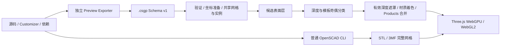

# Preview Exporter 与 Goldfeather 图像空间预览

Preview 有两条执行路径：默认的 Full Render 使用已选择的普通 OpenSCAD CLI，输出 STL/3MF 完整网格；实验性快速预览使用独立 Preview Exporter，输出 `.csgp`，由 Goldfeather 深度/模板渲染判定可见表面。

配置项为 `scad-ai-ide.preview.renderMode` 和 `scad-ai-ide.markdown.preview.renderMode`，默认均为 `render`。视口当前不挂载快速模式切换按钮和性能详情面板；加载、错误、相机导航、选择与测量保留。裁剪、线框与 XRay 切换入口隐藏。内部协议及计时仍用于宿主日志和回归测试。

## 执行边界



官方 C++ 完成局部几何求值、三角化及 Products 生成。浏览器消费网格、实例与 Products，在屏幕空间计算 Boolean 可见表面；不在 TypeScript 中解析完整 CSG 或求最终 Boolean 网格。Full Render 的通用拓扑 Worker 不接受 `.csgp`，快速预览也不隐式调用 Full Render。

## Goldfeather 渲染

算法对应 OpenCSG standard Goldfeather 的候选深度与奇偶分类：

1. 共享原始三角网格，以官方实例矩阵定位操作数；不反推 AST。
2. 正操作数选择正面、负操作数选择背面，按照 convexity 遍历候选层。
3. 将候选深度和有效标记写入纹理。
4. 对其他操作数以 `GREATER` 深度测试和 stencil `INVERT` 统计候选表面后方的交点，处理近裁面进入减法体的情况。
5. 正项要求奇数、减项要求偶数，不满足条件的候选标记被清零。
6. 按有效深度遮罩重绘表面，通过普通深度比较合并 Products。

互不接触的减项可以省略奇偶测试，单正项 Product 不需要 Boolean pass。相机变化只重新绘制；参数或源码变化重新请求 Exporter。CPU Products 查询服务拾取和表面点测量，不代替 GPU 渲染。

实现位于 [GoldfeatherRenderer](../src/features/preview/webview/preview/csg/GoldfeatherRenderer.ts) 和 [Preview 核心](../src/core/preview/)。它不是完整 OpenCSG Automatic/SCS、occlusion query 或全部批次优化的移植。

## 协议、交互与生命周期

外部 `.csgp` 使用 Schema v1，验证 source、tag、commit、行优先矩阵、RGBA、convexity、索引与引用完整性。内部 `preview-scene-1` 保存 meshes、instances、products、highlights、backgrounds、provenance、dependencies 和 timings；坐标经过局部重定位与数值缩放。

Highlight/Background 消费官方 Products，显式 RGBA 保留。着色使用 Three.js PBR，不保证与官方 OpenGL 的光照和透明像素逐一一致。候选遮罩和最终着色使用相同的单采样像素网格，避免采样位置差异导致接缝。

快速模式不生成精确最终拓扑，提供表面拾取与点测量；精确边/顶点测量及阴影使用 Full Render。网格、颜色和包围盒不能充当源码映射，当前不提供从模型准确跳转到 SCAD 源码的能力。

Host 会话、RendererJobs 和版本化 ModelRepresentation 管理取消及资源释放。迟到结果不能替换新模型。WebGPU 设备丢失后，WebGL2 恢复使用相同 Goldfeather 路径。宿主、Customizer 与 Markdown 生命周期见 [Preview 集成](preview-integration.md)。

## Exporter 安装

当前受支持的独立 Exporter 为 macOS ARM64：

- Release：`openscad-2026.11-RC0`；Schema：1。
- Commit：`9ba0cee7c94785fac0ca8dfe040b965a12a25ed1`。
- SHA256：`42ebdbe75f3d8bf25c61675f756c86206b6a14077a5ea078fad355babf69a14f`。

使用命令面板 **Install Preview Exporter** / **Select Preview Exporter**，或将 `scad-ai-ide.preview.exporterPath` 设置为包内 `bin/openscad-preview-exporter` 的绝对路径。安装校验发布 checksum、固定 SHA256、归档路径、Mach-O ARM64、build-info 和版本，独立于普通 CLI 管理。

```sh
openscad-preview-exporter --export-format=preview-scene -o model.csgp model.scad
```

IDE 使用 stdin、`$preview=true`、Customizer 覆盖、原文件 cwd 和 depfile。其他平台快速模式明确不可用，Full Render 使用相应平台的普通 CLI。

## 性能记录与限制

完成的预览将阶段数据写入 **SCAD AI IDE Preview** Output，前缀为 `[Preview pipeline]`。宿主记录执行、读取、解析、依赖与清理；Viewer 记录资源准备、上传、shader/pipeline、绘制提交和首帧确认。当前界面不提供性能详情表或 Raw JSON 按钮。

CPU 提交时间不是纯 GPU 时间，GPU 完成等待包含队列和读回开销。首帧确认不等于显示器已实际扫描输出；小计可能重叠，不应相加。Exporter 协议只提供进程整体时间，不能据此拆出其内部几何求值、三角化或归一化的独立耗时。Markdown 缺少完整宿主确认链时保留未知总时间。

标准 Goldfeather 依赖正确 convexity，模板层数超过 255 时明确拒绝。一般 2D Boolean、极端非流形/自交、复杂透明叠加、全部 GPU/驱动与平台尚未全面验收。快速模式未提供后处理抗锯齿，复杂 Products 的大量绘制提交仍可能较慢。普通 CLI 的 3MF 导出取决于该 CLI 是否编入相应能力。

## 验证

```sh
npm run package
npm test
SCAD_PREVIEW_EXPORTER=/absolute/bin/openscad-preview-exporter \
  SCAD_PREVIEW_EXPORTER_ARCHIVE=/absolute/exporter.tar.gz npm run test:preview-exporter
npm run test:preview-gpu
node --test scripts/preview-fast.test.mjs
SCAD_TEST_WEBGPU=1 node --test scripts/preview-fast.test.mjs
npm run test:markdown
SCAD_PREVIEW_EXPORTER=/absolute/bin/openscad-preview-exporter \
  npm run benchmark:preview -- .build/preview-benchmark.json
```

Exporter 二进制和归档必须来自已验证的安装；无运行时的跳过结果不能当作真实导出通过。GPU 测试检查真实画布，不应仅以 JavaScript 调用成功代替像素结果。VS Code 宿主回归及所需环境变量见 [开发说明](../CONTRIBUTING.md)。性能结论应以目标模型、设备、分辨率与实际采样为准。
