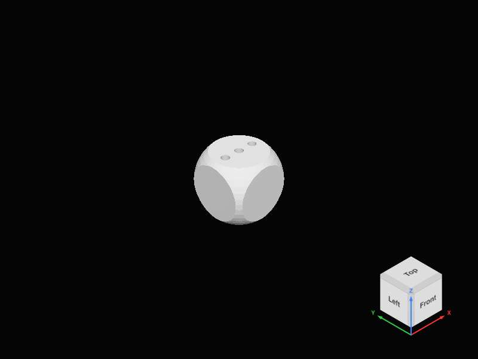

> 历史报告：本文件对应 `a5cf241` 的逐片元 Boolean 渲染器，该渲染器已删除。当前架构及验收见 [标准 Mesh 验收报告](preview-standard-mesh-validation.md)。

# Preview Exporter 验收记录

日期：2026-11-02。环境：macOS 27.0 / ARM64 / Apple M4 Pro；Node 24.16.0；Chromium 149.0.7827.55；VS Code 1.144.0。Builder 原生实验见 [独立实验](preview-exporter-experiment.md)，架构、删改模块与协议映射见 [架构文档](preview-exporter-architecture.md)。

## 自动化结果

| 实际执行                                                       | 结果                                                                             |
| -------------------------------------------------------------- | -------------------------------------------------------------------------------- |
| `npm run check-types`                                          | Extension Host 和 Webview TypeScript 均通过                                      |
| `npm run lint`                                                 | 通过                                                                             |
| `npm run package`                                              | 类型、Lint、生产构建及 license staging 通过                                      |
| `npm test`（设置原生 Exporter / 归档环境变量）                 | 129 个基础测试 + 82 个 Preview 测试通过；无跳过                                  |
| `npm run test:fast-preview` / 调度单测                         | 22 个协议/调度测试、20 个 WebGL2 交互用例通过；新增持续拖动不饥饿用例单独验证    |
| `node --test scripts/prepared-preview-gpu.test.mjs`            | 13 组模型 × WebGPU/WebGL2；每模型 132 个轮廓点与 CPU Products 查询对照；全部通过 |
| `SCAD_TEST_WEBGPU=1 node --test scripts/preview-fast.test.mjs` | 20 个真实 WebGPU 交互用例通过                                                    |
| `node --test scripts/markdown-preview.test.mjs`                | 10 个 Markdown 浏览器测试通过                                                    |
| `npm run test:integration`（VS Code + 原生 Exporter）          | 12 个语言 / LSP / Markdown / 扩展集成测试通过                                    |
| `npm run test:preview-editor`（独立 Exporter + 普通 CLI）      | 真实编辑器验收通过，退出码 0                                                     |
| `node --test scripts/markdown-webview.test.mjs`                | 内置与 extension-owned 真实 VS Code Markdown Webview，2/2 通过                   |
| `node --test scripts/customizer-scrollbar.test.mjs`            | 19/19 通过，无跳过                                                               |

原生 Exporter 测试覆盖下载 SHA 拒绝、完整归档安装/校验、重发现、损坏安装修复、普通 CLI/Exporter 的相互拒绝、真实 stdin、`$preview`、`-D`、`include` / `use` / `import` / `OPENSCADPATH`、依赖 stamp 改变、执行取消、真实解析错误、官方 C++ 拓扑及截面。

GPU 图像组包括 Cube、Sphere、Cylinder、镜像/旋转变换、Union、Difference、Intersection、多层 Boolean、凹多边形、十亿级坐标、远距离实例、共面切除与 0.000001 厚度模型。单测另外验证 Highlight/Background/alpha 元数据、空模型和非法协议拒绝。

交互测试覆盖原生参数与预设、未保存文本、相机和场景保留、拖动分辨率、帧版本、并发更新、资源销毁、XRay/线框/测量/截面、取消后不显示旧错误、GPU 设备恢复。新增单位测试验证编辑器平移/非均匀缩放后，拾取点和提交给 C++ 的裁剪平面仍一致。

独立 STL/3MF 的测量/裁剪无需 CLI：单独 Worker 测试验证 STL 裁剪范围，以及 3MF 单位和颜色保留。真实 RC0 普通 CLI 未编入 lib3mf，其 3MF 导出明确失败而不返回空模型；文件级 3MF 预览仍通过。

## 同条件性能

800×600、DPR 1、相同模型/灯光、关闭阴影。首样本指新建 viewer 资源，驱动 shader cache 已被回归测试预热，不等于系统首次安装。第二样本再次启动 CLI/Exporter，`$t` 从 0 变 1，模型所有尺寸扩大 1%；关闭结果缓存，包含实际参数变化。

旧版源码来自任务开始的 commit `829f1c6d711452daf773fe3a2a0e39434c29f5d6`，只在临时目录还原执行。两条路径使用相同 RC0 原生上游版本。旧版保留原 worker 与 renderer 的实际行为，未用旧文档数据冒充本次基准。

单位：毫秒；总时间从调用开始到实际 GPU 完成的首帧确认。

| 模型                  | 后端   | 旧首次 | 新首次 | 旧参数更新 | 新参数更新 |
| --------------------- | ------ | -----: | -----: | ---------: | ---------: |
| Cube                  | webgpu |    150 |     58 |         91 |         58 |
| Cube                  | webgl2 |    204 |     89 |        109 |         83 |
| 嵌套 Boolean + 3 个孔 | webgpu |    133 |    100 |         99 |         90 |
| 嵌套 Boolean + 3 个孔 | webgl2 |    167 |    150 |        108 |        118 |
| 64 实例               | webgpu |    126 |     66 |        100 |         67 |
| 64 实例               | webgl2 |    142 |     92 |        116 |         92 |

五种模型共 20 个新样本的原始分阶段数据在 [新管线 JSON](preview-exporter-benchmark.json)；[旧管线 JSON](preview-exporter-legacy-baseline.json) 包含 CLI、worker、shader、upload、首帧及总时间。

结论：旧 worker 的约 44–57 ms 预处理被移除，新 JSON/Scene 转换在本组样本约 0.1–2 ms。共享材质显著降低了实例数造成的 shader 构建开销。新方案在这些首次样本上较快，WebGL2 的复杂 Boolean 参数更新仍略慢于旧版。样本量有限，没有声称所有模型和设备均更快；首次驱动编译、复杂重叠和显式拓扑操作仍可能更慢。




## 复现

```sh
export SCAD_PREVIEW_EXPORTER=/absolute/package/bin/openscad-preview-exporter
export SCAD_PREVIEW_EXPORTER_ARCHIVE=/absolute/openscad-preview-exporter-macos-arm64.tar.gz
export SCAD_VSCODE_EXECUTABLE=/absolute/Code
# 真实 Full Render 回归另设 SCAD_OPENSCAD_EXECUTABLE，指向普通 CLI。
npm test
npm run test:fast-preview
npm run test:preview-gpu
SCAD_TEST_WEBGPU=1 node --test scripts/preview-fast.test.mjs
npm run test:integration
npm run test:preview-editor
npm run benchmark:preview -- docs/preview-exporter-benchmark.json
```

## 尚未完成的验证或功能

1. 快速预览的投影阴影未实现，Full Render 阴影保留。
2. v1 没有逐面材质数据；不能宣称还原它未提供的逐面材质或 AST。
3. 复杂透明重叠、极端自交/非流形/多重相切及更大设备压力，尚未进行广泛官方 F5 像素对照。标准 RGBA blending 和已列出的几何测试已通过。
4. 当前原生构建仅 macOS ARM64；其他平台快速预览明确不可用，无旧后端回退。
5. 本机 RC0 普通 CLI 的真实 3MF 导出受 `lib3mf=false` 限制，已验证错误处理；未把它标作成功导出。

## Git 交付

直接在 `main` 完成，无新分支、无 PR。只提交任务改造、测试与文档；用户原有未跟踪需求文档保留未提交。最终 commit 以交付消息中的实际 `git log -1` 为准。
